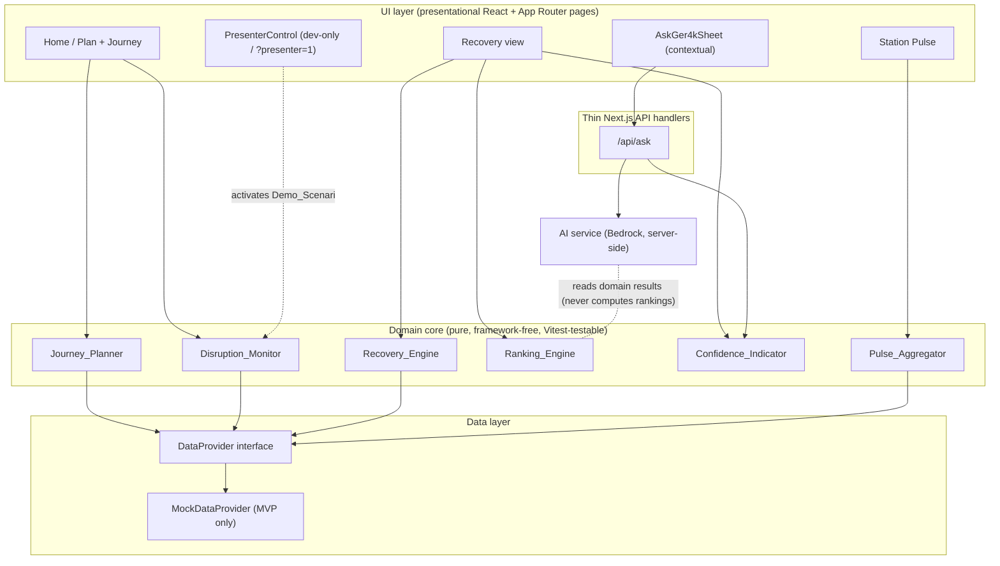
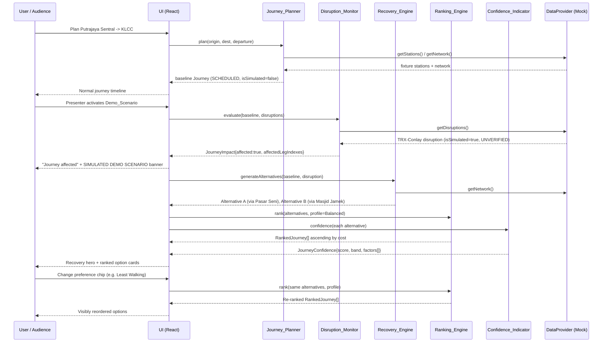
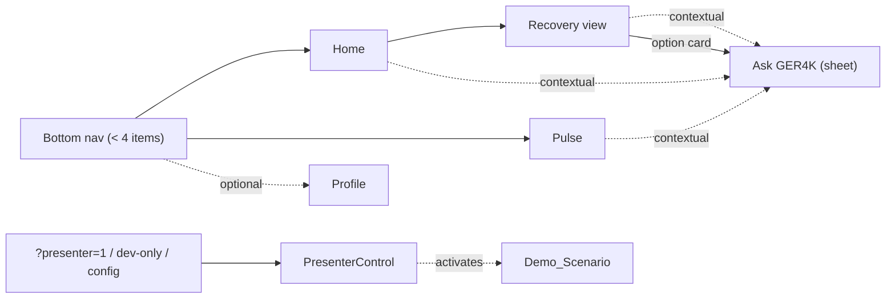
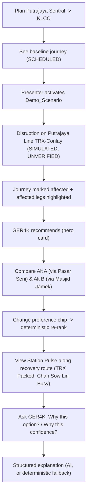
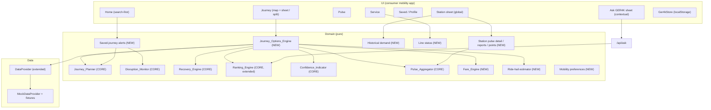
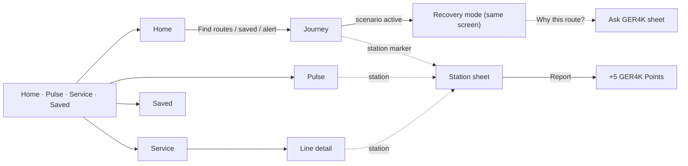

# Design Document

## Overview

GER4K by **4WARD.AI** is a Malaysian public-transport **disruption-recovery
companion** for Klang Valley commuters. Its promise is simple: **normal day:
plan; bad day: recover.** On a normal day GER4K plans a multimodal journey. When
a disruption affects that journey, GER4K detects the impact, generates and ranks
alternative recovery options, and explains them honestly with clear source and
simulation labelling.

The organizing design principle is: **the more chaotic the transport network
becomes, the calmer and more decisive GER4K should become.** As conditions
degrade, the product should reduce noise and surface one confident
recommendation plus a short, honest comparison — not a wall of raw data.

### Hackathon priority (explicit)

This is a **hackathon MVP** for the HACKSPIRE LUMINA demo. A **polished,
reliable, end-to-end demo matters more than architectural completeness.** When a
trade-off appears, we favour the demo working flawlessly over covering every
edge or building future-facing abstractions. The design stays
**beginner-understandable**: four clear layers, pure domain logic, a single mock
data source, and minimal dependencies.

### The must-always-work demo chain (8 steps)

1. **Normal journey** — plan Putrajaya Sentral → KLCC and show the baseline
   multimodal route.
2. **Simulated disruption** — the presenter activates the Demo_Scenario.
3. **Journey affected** — Disruption_Monitor marks the baseline journey affected
   and shows which legs.
4. **GER4K recovery recommendation** — a hero recommendation appears.
5. **Alternative comparison** — at least two ranked alternatives with time /
   transfers / walking and confidence.
6. **Preference re-ranking** — preference chips deterministically re-order the
   same alternatives.
7. **Station Pulse** — aggregated station conditions along the recovery route.
8. **Contextual Ask GER4K explanation** — a plain-language explanation of *why
   this option* / *why this confidence*, degrading to deterministic text if AI
   is unavailable.

Station Pulse **submission** and **trust points** are **supporting features**,
implemented only if time permits. There is **no authentication, payments,
production infrastructure, machine learning, or extra external APIs** in the MVP.

## Architecture

### High-level approach

GER4K is a **single Next.js 15.x application** (App Router, TypeScript), pinned
to the 15.x line (do not auto-upgrade to a newer Next.js major). It is
mobile-first, styled with **Tailwind CSS**, optionally using **shadcn/ui** for a
small set of polished primitives. The only backend is a set of **thin Next.js
API route handlers** — no separate server, no microservices.

The system has **four layers with a strict dependency direction**:

- **UI layer** — presentational React components and App Router pages. They
  render and orchestrate; they never implement transport intelligence.
- **Thin API handlers** — `src/app/api/*`. The only one the MVP truly needs is
  `/api/ask` (Ask GER4K). Handlers validate input and delegate to the domain /
  services.
- **Domain core** — pure, framework-free TypeScript (`src/domain/*`). It imports
  **no React/Next** and **never imports the AI layer**. It is independently
  unit-testable with Vitest.
- **Data layer** — the `DataProvider` interface and its MVP implementation
  (`src/data/*`).

Dependency direction is strictly **UI → API → Domain → Data**. The Domain never
reaches "up" into React/Next or "sideways" into AI. The AI service consumes
domain results; it never produces them.

### Minimal dependencies and data flow

The MVP deliberately avoids client-cache libraries. It uses **built-in
React/Next state plus plain `fetch`**. **Do not add SWR, TanStack Query, or any
other client-cache library.** Most screens compute **synchronously and in-memory**
against the `MockDataProvider`; journey planning, disruption detection, recovery
generation, ranking, confidence, and Pulse aggregation are all pure, local
computations. The **only network call** in the MVP is **Ask GER4K → `/api/ask`**.

### System / architecture diagram



Key constraint shown above: the **Domain core depends only on the
`DataProvider` interface**, and the **AI service is off to the side** — it reads
domain results to explain them and never feeds back into ranking or confidence.

### Plan → recover request lifecycle



## Components and Interfaces

### Domain components (pure, deterministic, Vitest-testable)

All of these live under `src/domain/` and import no React/Next and no AI code.

- **Journey_Planner** — builds a multimodal `Journey` from origin, destination,
  and departure time using the fixture network via the `DataProvider`.
- **Disruption_Monitor** — given a `Journey` and the active `Disruption[]`,
  computes a `JourneyImpact` (affected flag + affected leg indexes).
- **Recovery_Engine** — given an affected `Journey` and the disruption, generates
  one or more alternative `Journey`s that **avoid the blocked segment**.
- **Ranking_Engine** — orders alternatives deterministically for a selected
  `PreferenceProfile` (weighted min–max normalized cost; see MVP Algorithms).
- **Confidence_Indicator** — computes an explainable `JourneyConfidence` (score,
  band, and the list of contributing factors) for a journey.
- **Pulse_Aggregator** — aggregates recent `CommunityReport`s for a station into
  a `PulseSummary` with a condition and a confidence band.

### Data provider interface (MVP = MockDataProvider only)

A single **framework-free `DataProvider` interface** (no React/Next imports,
independently testable) is the only way domain code reaches data:

```ts
interface DataProvider {
  getStations(): Station[];
  getNetwork(): TransportNetwork;
  getDisruptions(): Disruption[];
  getReports(stationId: string): CommunityReport[];
  submitReport(newReport: NewCommunityReport): CommunityReport;
}
```

The **MVP implements only `MockDataProvider`**, backed by the corrected demo
fixture (see Data Models → Demo fixture). Operations are synchronous and
in-memory.

Documented **behind the same interface but NOT built for the MVP**:

- `StaticGtfsProvider` — GTFS static stops/routes/schedules as the base network.
- `LiveTransportProvider` — real-time feeds where genuinely available.
- real `CommunityProvider` — persisted community reports.

This keeps the swap path honest without expanding hackathon scope.

### Separation of labels (two independent axes)

GER4K **always carries and displays two independent axes** so the UI never
conflates them:

- **`sourceStatus`** — information-source confidence: `LIVE`, `SCHEDULED`,
  `OPERATOR_CONFIRMED`, `COMMUNITY_REPORTED`, `UNVERIFIED`.
- **`isSimulated`** (Data_Mode) — whether a record belongs to a simulated demo
  scenario (`true`/`false`).

Rules enforced throughout:

- A **simulated disruption is NEVER `OPERATOR_CONFIRMED`** — it carries
  `UNVERIFIED` or `SCHEDULED` as the scenario dictates.
- **`SCHEDULED` is never shown as `LIVE`.**
- The **"SIMULATED DEMO SCENARIO"** indication is driven by `isSimulated`
  independently of `sourceStatus`.

#### Data-source boundary table (reflects the corrected fixture)

| Record | sourceStatus | isSimulated | Shown as |
|---|---|---|---|
| Baseline legs (Putrajaya Sentral → Ampang Park → KLCC) | `SCHEDULED` | false | Scheduled |
| Demo disruption (Putrajaya Line TRX–Conlay) | `UNVERIFIED` | true | Simulated, unverified, Severe disruption |
| Recovery Alternative A (via Pasar Seni) legs | `SCHEDULED` | false | Scheduled alternative |
| Recovery Alternative B (via Masjid Jamek) legs | `SCHEDULED` | false | Scheduled alternative |
| Pulse seed — TRX = Packed | `COMMUNITY_REPORTED` | false | Community-reported |
| Pulse seed — Chan Sow Lin = Busy | `COMMUNITY_REPORTED` | false | Community-reported |
| Pulse seed — Pasar Seni = Busy/Normal (optional) | `COMMUNITY_REPORTED` | false | Community-reported |
| New live submission | `UNVERIFIED` | false | Just reported, unverified |

### Information architecture / navigation

> **Superseded by the Full Vision Prototype IA** (see "Full Vision Prototype
> Design → Information architecture" below): navigation is now Home, Pulse,
> Service and Saved/Profile. The rules about no AI tab, contextual Ask GER4K and
> gated Presenter Control are unchanged.

- **Bottom navigation has fewer than four items: Home, Pulse, and an optional
  Profile.** There is **no "GER4K AI" tab.**
- **Ask GER4K is a contextual surface** (sheet / panel / modal), exposed from:
  the current/affected journey, the recovery view, recovery option cards ("Why
  this option?" / "Why this confidence?"), and Pulse. Responses are structured
  and actionable, and the **AI never computes rankings.**
- **Presenter / Demo Control is separated from passenger features** — it is a
  discreet demo toolbar that is **dev-only or query-param / config-gated** (e.g.
  `?presenter=1`). It is **not** in Profile. The audience always sees the
  "SIMULATED DEMO SCENARIO" indication independently of `sourceStatus`.

#### Screen list

- **Home** — plan input + baseline journey timeline; entry point to recovery
  when affected.
- **Recovery view** — hero recommendation, ranked option cards, preference
  chips.
- **Station Pulse** — aggregation-first station condition summaries (+ optional
  submission form if time permits).
- **Profile** (optional) — trust points if implemented; no demo control here.
- **Ask GER4K** (contextual overlay, not a tab).
- **Presenter control** (discreet, gated — not a passenger screen).

#### IA / navigation diagram



#### Primary user flow



### UI components (reusable, presentational)

- **BottomNavigation** — Home / Pulse / optional Profile. No AI tab, no demo
  control.
- **JourneyTimeline** — route timeline with a per-leg source tag; highlights
  affected legs.
- **RecoveryHeroCard** — "GER4K recommends" top recommendation.
- **RecoveryOptionCard** — time / transfers / walking + confidence band + source
  tag + contextual Ask GER4K entry point.
- **PreferenceChips** — Balanced / Fastest / Least Walking / Fewest Transfers →
  deterministic re-rank.
- **ConfidenceBadge** — 0–100 score + High/Medium/Low band + "Why this
  confidence?" reveal (lists factors).
- **SourceStatusTag** — renders `sourceStatus`.
- **SimulatedBanner** — "SIMULATED DEMO SCENARIO" (driven by `isSimulated`).
- **StationPulseCard** — aggregation-first station summary.
- **AskGer4kSheet** — calls `/api/ask`; degrades to deterministic text.
- **PresenterControl** — dev-only / query-param / config-gated.

### AI service and `/api/ask`

The AI service lives in `src/services/ai/` behind a provider interface
(preferred provider: **Amazon Bedrock**). `/api/ask` runs **server-side only**,
never exposing credentials to the client. It receives already-computed domain
results (the ranked alternatives and their confidence factors) and asks the AI
to **explain / personalize** them. If the user expresses a preference in natural
language, the AI maps it to a supported `PreferenceProfile` and requests a
re-rank — it does **not** compute the ranking. If the AI is unavailable, the
handler returns a **deterministic explanation** assembled from the confidence
factors and comparison attributes.

## Data Models

```ts
// Independent label axes
type SourceStatus =
  | "LIVE" | "SCHEDULED" | "OPERATOR_CONFIRMED"
  | "COMMUNITY_REPORTED" | "UNVERIFIED";

type StationCondition = "Normal" | "Busy" | "Packed" | "Severe disruption";

type PreferenceProfile = "Balanced" | "Fastest" | "Least Walking" | "Fewest Transfers";

type ConfidenceBand = "High" | "Medium" | "Low";

interface Labelled {
  sourceStatus: SourceStatus;
  isSimulated: boolean;
}

interface Station {
  id: string;
  name: string;
  lines: string[];
}

interface JourneyLeg extends Labelled {
  from: string;          // station id
  to: string;            // station id
  mode: string;          // MRT / LRT / Monorail / KTM / Rapid KL Bus / MRT Feeder
  line?: string;
  travelTimeMin: number;
  walkMeters: number;
}

interface Journey extends Labelled {
  id: string;
  legs: JourneyLeg[];
  totalTimeMin: number;
  transfers: number;
  totalWalkMeters: number;
}

interface Disruption extends Labelled {
  id: string;
  affectedSegment: { from: string; to: string; line?: string };
  severity: StationCondition; // e.g. "Severe disruption"
}

interface JourneyImpact {
  affected: boolean;
  affectedLegIndexes: number[];
}

interface ConfidenceFactor { label: string; delta: number; }

interface JourneyConfidence {
  score: number;        // 0..100
  band: ConfidenceBand;
  factors: ConfidenceFactor[];
}

interface RankedJourney {
  journey: Journey;
  rank: number;
  confidence: JourneyConfidence;
}

interface CommunityReport extends Labelled {
  id: string;
  stationId: string;
  condition: StationCondition;
  timestamp: string;    // ISO
}

interface NewCommunityReport {
  stationId: string;
  condition: StationCondition;
}

interface PulseSummary extends Labelled {
  stationId: string;
  condition: StationCondition;
  reportCount: number;
  mostRecentAt: string | null;
  confidence: { band: ConfidenceBand };
}
```

### Community report lifecycle (corrected)

- **New user submission → `sourceStatus = UNVERIFIED`.**
- **Seeded / corroborated condition → `COMMUNITY_REPORTED`.**
- **Automatic verification promoting `UNVERIFIED → COMMUNITY_REPORTED` is a
  FUTURE capability** (not built for the MVP).

### Corrected realistic demo fixture

> The fixture network is **intentionally limited** — only the stations and
> segments this scenario needs. We do **not** model the whole Klang Valley
> network.

**Normal baseline journey — Putrajaya Sentral → KLCC:**

1. **MRT Putrajaya Line:** Putrajaya Sentral → Ampang Park. (This Putrajaya Line
   portion passes through the **TRX–Conlay** segment en route to Ampang Park.)
2. **Interchange at Ampang Park:** Putrajaya Line → Kelana Jaya Line.
3. **LRT Kelana Jaya Line:** Ampang Park → KLCC.

All baseline legs are `SCHEDULED`, `isSimulated = false`.

**Simulated disruption:** affects the **Putrajaya Line segment between TRX and
Conlay**. This prevents the baseline journey from continuing toward Ampang Park,
so **Disruption_Monitor marks the baseline journey affected**. The disruption is
`isSimulated = true`, `sourceStatus = UNVERIFIED` (never `OPERATOR_CONFIRMED`),
severity `Severe disruption`, displayed as **"SIMULATED DEMO SCENARIO"**.

**Recovery Alternative A — via TRX / Pasar Seni:**
Putrajaya Sentral → Putrajaya Line → **TRX** → interchange to **Kajang Line** →
**Pasar Seni** → interchange to **Kelana Jaya Line** → KLCC. (Leaves the
Putrajaya Line at **TRX**, *before* the blocked TRX–Conlay segment.)

**Recovery Alternative B — via Chan Sow Lin / Masjid Jamek:**
Putrajaya Sentral → Putrajaya Line → **Chan Sow Lin** → interchange to
**Ampang / Sri Petaling Line** → **Masjid Jamek** → interchange to **Kelana Jaya
Line** → KLCC. (Leaves the Putrajaya Line at **Chan Sow Lin**, avoiding the
blocked segment.)

Both alternatives **genuinely avoid the TRX–Conlay Putrajaya Line segment** and
both reach KLCC on the **Kelana Jaya Line** via a **real interchange** (Pasar
Seni for A, Masjid Jamek for B). Their `travelTimeMin`, `walkMeters`, and
`transfers` are tuned so the two have **meaningful trade-offs** and the
preference chips **visibly change the ranking** — e.g. one is faster but with
more walking/transfers, the other is lower-walking or fewer-transfers but slower
— **without inventing impossible connections.** Suggested starting values (tune
during implementation to keep the re-rank visible):

| Alternative | travelTimeMin | transfers | totalWalkMeters |
|---|---|---|---|
| A — via Pasar Seni | ~34 | 2 | ~520 |
| B — via Masjid Jamek | ~41 | 2 | ~260 |

With these, **Fastest** favours A and **Least Walking** favours B, so chips
re-rank visibly. Keep both reaching KLCC via the Kelana Jaya Line.

**Station Pulse seeds** (seeded/corroborated → `COMMUNITY_REPORTED`; live
submissions still start `UNVERIFIED`):

- **TRX = Packed**
- **Chan Sow Lin = Busy**
- optionally **Pasar Seni = Busy/Normal** if useful to explain Route A.

## Correctness Properties

These are short plain invariants the implementation and tests must uphold. They
are **not** a property-based-testing mandate — they are the behavioural truths
the small Vitest suite verifies with focused examples.

### Property 1: Labels are never conflated

For every displayed record, `sourceStatus` and `isSimulated` are carried and
presented as two independent values; neither is derived from or collapsed into
the other.
**Validates: Requirements 2.1, 2.2**

### Property 2: Scheduled is never shown as live

No `SCHEDULED` record is ever presented as `LIVE` anywhere in the UI or domain.
**Validates: Requirements 2.4**

### Property 3: Simulated is never operator-confirmed

Any record with `isSimulated = true` (including the demo disruption) carries a
non-operator-confirmed `sourceStatus`; it is never `OPERATOR_CONFIRMED`.
**Validates: Requirements 4.4, 4.5**

### Property 4: Recovery avoids the blocked segment

Every alternative journey produced by the Recovery_Engine for the demo
disruption contains no leg traversing the blocked TRX–Conlay Putrajaya Line
segment.
**Validates: Requirements 5.1**

### Property 5: Ranking is deterministic with defined tie-break

For a fixed set of alternatives and a fixed `PreferenceProfile`, ranking yields
the same order every time, sorted ascending by cost, tie-broken by shortest
`travelTimeMin` and then by stable journey id.
**Validates: Requirements 6.1, 6.2, 6.3**

### Property 6: Confidence is explainable

A journey's confidence `score` equals the base value plus the listed factor
deltas clamped to [0,100], its `band` matches the score thresholds, and the
"Why this confidence?" reveal lists exactly those factors.
**Validates: Requirements 6.4**

### Property 7: New reports start unverified

Every newly submitted community report is recorded with
`sourceStatus = UNVERIFIED`.
**Validates: Requirements 9.2**

### Property 8: Pulse aggregation is cautious on ties

When weighted support ties between conditions, the Pulse_Aggregator selects the
more severe condition.
**Validates: Requirements 7.2, 7.4**

## MVP Algorithms

### Recovery ranking (deterministic, no ML)

Rank alternatives by a **weighted sum of min–max normalized attributes**
`{ travelTimeMin, transfers, totalWalkMeters }`; **lower cost ranks higher**.

Per-profile weights `(wTime / wTransfers / wWalk)`:

| Profile | wTime | wTransfers | wWalk |
|---|---|---|---|
| Balanced | 1.0 | 1.0 | 1.0 |
| Fastest | 3.0 | 0.5 | 0.5 |
| Least Walking | 0.5 | 0.5 | 3.0 |
| Fewest Transfers | 0.5 | 3.0 | 0.5 |

For each attribute, min–max normalize across the candidate set to `nTime`,
`nTransfers`, `nWalk` in `[0,1]` (if an attribute is constant across candidates,
its normalized value is 0). Then:

```
cost = wTime * nTime + wTransfers * nTransfers + wWalk * nWalk
```

Sort **ascending by cost**. **Tie-break:** shortest `travelTimeMin`, then stable
journey `id`.

### Journey confidence (explainable indicator)

Journey Confidence is an **explainable product confidence indicator**, **not** a
scientifically validated probability of successful arrival. Start from **base
60** and apply additive factor deltas, clamping the final score to `[0,100]`:

| Factor | Delta |
|---|---|
| Any leg `LIVE` / `OPERATOR_CONFIRMED` | +20 |
| Journey `SCHEDULED` | +5 |
| Any leg `UNVERIFIED` | −20 |
| Relies on scheduled where live expected | −5 |
| Per transfer beyond the first | −4 |
| Recent Pulse info present on route | +8 |
| Recent Pulse Packed / Severe on route | −10 |
| `isSimulated` or mixed/unknown tags | −8 |

**Bands:** High ≥ 75, Medium 50–74, Low < 50. Return `factors[]` as
`{ label, delta }` for the "Why this confidence?" reveal.

### Station Pulse aggregation (deterministic, no ML)

- **Recent window:** 30 minutes. If there are no recent reports → `Normal`, Low
  confidence.
- **Severity map:** Normal = 0, Busy = 1, Packed = 2, Severe disruption = 3.
- **Recency weighting:** reports in the last **10 minutes count double**.
- Pick the condition with the **highest weighted support**. **Tie-break: prefer
  the more severe / worse condition** (cautious).
- Report `reportCount` and `mostRecentAt`.

### Station Pulse confidence bands (freshness + support)

- **High** — most recent ≤ 10 min **and** ≥ 3 recent reports.
- **Medium** — most recent ≤ 30 min **and** ≥ 1 recent report.
- **Low** — otherwise.

## Visual Direction

> **Superseded.** The implemented app already moved to a light consumer theme,
> and the Full Vision Prototype formalises it (see "Full Vision Prototype Design
> → Visual system"). The dark list below is kept for history only.

- **Identity:** deep midnight-navy base (`#080B14` / `#0D1120` / `#12172A`).
- **Violet intelligence accent** (`#7C3AED` / `#8B5CF6` / `#A855F7`) used
  sparingly for GER4K intelligence moments.
- **Cyan transit accent** (`#22D3EE` / `#38BDF8`) for transit elements.
- **Success green**, **warning amber**, and a **restrained critical red used
  ONLY on affected segments.**
- **Typography:** Inter / Geist / Manrope with a clear large / medium / small
  hierarchy. **Lucide** icons.
- **Terminology:** Klang Valley transit language — MRT / LRT / Monorail / KTM /
  Rapid KL Bus / MRT Feeder / interchange.
- **Layout:** mobile-first at **390px**; polished desktop/projector layout
  centered at max ~**1200–1400px** (left route timeline, right
  recovery/Pulse/AI).
- **Disruption info hierarchy:** (1) am I affected → (2) what should I do →
  (3) how long → (4) how reliable → (5) station conditions → (6) why recommended
  → (7) source details last.
- **Station Pulse** is "Waze for transit" — **aggregation-first**.
- **Confidence / source transparency** is always visible.
- **Empty states:** no disruption / no pulse reports / AI unavailable.
- **Loading:** transport-oriented loading messages + skeletons.
- **Microinteractions:** 150–300ms.
- **Accessibility:** sufficient contrast; **label + icon, never color alone**;
  large tap targets; visible focus; no critical info conveyed by animation only.
- **Map** is secondary / optional.

## Error Handling

- **NoRouteFound** — Journey_Planner cannot build a plan → display a clear "no
  route found" message. *(1.3)*
- **NoAlternativeFound** — Recovery_Engine produces no valid alternative →
  display a clear "no alternative route found" message. *(5.4)*
- **Invalid report** — a submission missing a required field is rejected with a
  message naming **which field** is required. *(9.4)*
- **AI unavailable** — still show alternatives, ranking, confidence, and Pulse,
  plus a **deterministic explanation** assembled from the confidence factors.
  *(10.3)*
- **Credentials** — AI/AWS credentials stay **server-side only** and are never
  exposed to the client. *(10.4)*
- **Empty Pulse window** — treated as `Normal` / Low confidence, **not** an
  error.

## Testing Strategy

The MVP uses a **small, focused Vitest suite** run in **single-run mode
(`vitest run`, no watch)**. Because every core computation is a pure domain
function, **example-based unit tests** are prioritized and sufficient for the
hackathon. Property-based testing is **optional future hardening, not an MVP
requirement**, and **no `fast-check` dependency is added.**

Prioritized example-based unit tests:

- **Normal journey generation** — baseline Putrajaya Sentral → KLCC produces the
  expected legs and totals.
- **Disruption detection** — the TRX–Conlay disruption marks the baseline
  journey affected with the correct affected leg indexes.
- **Recovery alternatives avoid the blocked segment** — Alternatives A (via
  Pasar Seni) and B (via Masjid Jamek) both avoid the TRX–Conlay Putrajaya Line
  segment and reach KLCC via the Kelana Jaya Line.
- **Deterministic preference ranking** — each profile orders A and B as expected
  (e.g. Fastest → A, Least Walking → B) with the defined tie-break.
- **Confidence-band boundaries** — scores at 74/75 and 49/50 map to the correct
  bands, and `factors[]` sum to the clamped score.
- **Station Pulse aggregation** — seeded reports (TRX = Packed, Chan Sow Lin =
  Busy) aggregate to the expected condition, including the cautious tie-break and
  the empty-window → Normal/Low case.
- **One end-to-end demo-scenario smoke test** — drives the full 8-step chain on
  the corrected fixture: plan → activate Demo_Scenario → affected → recovery →
  ranked comparison → re-rank by preference → Pulse summary → deterministic
  explanation.

These tests assert against the **corrected fixture only** (Putrajaya Sentral →
KLCC baseline; TRX–Conlay disruption; A via Pasar Seni; B via Masjid Jamek; TRX
Packed / Chan Sow Lin Busy Pulse seeds) and contain no references to any earlier
route or segment.

---

# Full Vision Prototype Design

## Tiers

| Tier | What it covers | Status |
|---|---|---|
| **CORE / ALREADY WORKING** | Journey_Planner, Disruption_Monitor, Recovery_Engine, Ranking_Engine, Confidence_Indicator, Pulse_Aggregator, MockDataProvider, `/api/ask` + deterministic fallback, Presenter Control, Vitest suite, Amplify config | Preserved. Extended additively only. |
| **FULL VISION PROTOTYPE** | Fare, rich comparison, 7 profiles, transit map, multimodal options, search-first Home, in-place recovery, ride-hail fallback, contextual Pulse, structured reports + points, Service, historical demand, saved journeys + proactive alert, mobility needs, Ask co-pilot, consumer layout | This design. |
| **PRODUCTION / FUTURE** | Auth, payments, rewards economy, push infrastructure, moderation/verification, GTFS pipeline, GTFS Realtime dependency, full coverage, backend services | Not built. |

Product promise is unchanged — **normal day: help me plan; bad day: help me
recover** — but GER4K now answers the question other planners do not:
**"My journey has changed. What should I do now?"**

## Architecture additions

The four-layer rule (UI → API → Domain → Data) is unchanged. New domain modules
are pure, framework-free and Vitest-tested. Existing CORE modules keep their
behaviour; the only CORE edits are additive (new optional type fields, new
profiles/weights, two recognised source statuses, fixture stations).



## Information architecture

Primary navigation (mobile bottom bar, desktop top bar): **Home · Pulse ·
Service · Saved**. No AI tab. Presenter Control remains gated (`?presenter=1`,
dev, or `NEXT_PUBLIC_PRESENTER`) and separate.

| Route / surface | Purpose |
|---|---|
| `/` Home | "Where are you going?" search, proactive alert, saved + recent journeys, relevant service status, nearby/relevant transport (official feeder routes, simulated arrivals). Desktop: left panel + network map. |
| `/journey?from&to&when&time` | Journey results. Normal mode: recommended + strategy alternatives. Recovery mode (same screen): "Your journey has changed" → "GER4K recommends" → alternatives → ride-hail fallback → original route. Step details, fare breakdown, journey mode, save, Ask entry points. Desktop split 38/62 with map; mobile map + overlapping sheet. |
| `/pulse` | Browse station conditions, worst first; quick report entry. |
| `/service`, `/service/[lineId]` | Line list with status; line detail layered Service notice → Community → GER4K for your journey; official bus routes with GTFS headways. |
| `/profile` (tab label "Saved") | Saved journeys, preferred profile, mobility needs, GER4K Points + level, roadmap concept, local data controls. |
| Station sheet (global overlay) | Condition, count, freshness, Pulse confidence, trend, signals, historical demand, Report condition, See reports. Opened from map markers, route details, Pulse, Service. |
| Ask GER4K sheet (contextual) | Structured co-pilot answers with suggestion + follow-ups. |



## Data models (additions)

All CORE types keep their shape; new fields are optional so existing code and
tests compile unchanged.

```ts
// labels.ts
type SourceStatus = "LIVE" | "SCHEDULED" | "OPERATOR_CONFIRMED"
  | "COMMUNITY_REPORTED" | "UNVERIFIED" | "HISTORICAL" | "ESTIMATED";
type PreferenceProfile = "Balanced" | "Fastest" | "Least Walking"
  | "Fewest Transfers" | "Cheapest" | "Avoid Crowding" | "Accessible";

// network.ts (optional extensions)
interface Station { id; name; lines; codes?: string[]; lat?: number; lon?: number; isOKU?: boolean }
interface NetworkLine { id; name; mode; stationIds;
  kind?: "rail" | "bus" | "replacement-bus"; shortName?: string;
  headwayMin?: number; isSimulated?: boolean }
interface NetworkSegment { from; to; lineId; mode; travelTimeMin; walkMeters; fareSen?: number }
interface WalkLink { from: string; to: string; walkMeters: number; walkTimeMin: number }
interface TransportNetwork { stations; lines; segments; interchanges; walkLinks?: WalkLink[] }

// journey.ts (optional extensions)
interface JourneyLeg { …; legKind?: "ride" | "walk" | "ride-hail"; lineId?: string; headwayMin?: number }
interface Journey { …; fareSen?: number; crowdLevel?: number; accessIssues?: number }

// fare.ts
interface FareItem { label: string; amountSen: number; legIndexes: number[]; note?: string }
interface JourneyFare extends Labelled { totalSen: number; items: FareItem[] } // ESTIMATED

// options.ts
type StrategyTag = "Fastest" | "Cheapest" | "Least walking" | "Fewest changes" | "Least crowded";
interface JourneyOption {
  id: string; title: string; journey: Journey; fare: JourneyFare;
  confidence: JourneyConfidence; strategies: StrategyTag[]; rank: number;
  touchStationIds: string[]; pathStationIds: string[];
  hasBus: boolean; isSimulated: boolean;
}
interface RideHailEstimate extends Labelled {   // ESTIMATED, not simulated
  hailStationId: string; destinationId: string; railJourney: Journey;
  rideMinRange: [number, number]; totalMinRange: [number, number];
  rideCostSenRange: [number, number]; totalCostSenRange: [number, number];
  roadKm: number;
}
interface JourneyOptionsResult {
  mode: "normal" | "recovery";
  options: JourneyOption[];     // meaningful, ranked for the profile
  candidates: JourneyOption[];  // all validated candidates (for Ask "bus option?")
  rideHail: RideHailEstimate | null;
}

// pulse.ts (extensions)
type StationReportType = "Normal" | "Busy" | "Packed" | "Cannot board" | "Delay"
  | "Train moving slowly" | "Train stopped" | "Replacement bus available"
  | "Entrance closed" | "Lift/escalator issue";
interface CommunityReport { …; reportType?: StationReportType }
interface NewCommunityReport { stationId; condition; reportType?: StationReportType }
interface StationPulseDetail {
  summary: PulseSummary; trend: "rising" | "steady" | "easing";
  signals: { type: StationReportType; count: number; mostRecentAt: string }[];
}

// service / demand / profile
interface LineStatus extends Labelled { lineId; status: "Normal" | "Disrupted";
  notice?: string; affectedStationIds: string[]; communityNotes: string[] }
interface HistoricalDemandRecord { stationName; avgWeekdayTrips; rank; of; percentile }
type DemandBand = "HIGH" | "MEDIUM" | "LOW";
interface SavedJourney { id; label; originId; destinationId; createdAt }
type MobilityNeed = "less-walking" | "fewer-transfers" | "avoid-stairs"
  | "wheelchair" | "elderly";
interface PointsState { total: number; acceptedReports: number }
type ContributorLevel = "New Contributor" | "Reliable Contributor" | "Community Helper";
```

`DataProvider` gains: `getMultimodalNetwork({ includeScenarioServices })`,
`getScenarioReports(stationId)`, `getLineInfo()`, `getHistoricalDemand()`,
`getFareRules()` and optional `restoreReports(reports)`. `getNetwork()` still
returns the CORE rail network so CORE behaviour and tests are unchanged.

## Fixture changes (CORE fixture, additive)

- **New stations** on existing lines, from official GTFS: Persiaran KLCC
  (Putrajaya Line, between Conlay and Ampang Park), Bukit Bintang and Merdeka
  (Kajang Line, between TRX and Pasar Seni). Segments are split so every CORE
  total is unchanged: baseline 28 / 1 / 180, Alt A 34 / 2 / 520, Alt B 41 / 2 / 260.
- **Official station metadata** from GTFS `rapid-rail-kl` (codes, lat/lon,
  `isOKU`), extracted at development time.
- **Demo segment fares** (`fareSen`) chosen so baseline = RM4.20, Alt A =
  RM4.40, Alt B = RM4.20, Putrajaya Line to Persiaran KLCC = RM3.80.
- **Pulse seeds** are stored as minutes-ago offsets and materialised relative to
  "now" on every read, so they never age out of the 30-min window mid-demo. TRX
  carries 12 reports (Busy earlier, Packed / Cannot board recently → rising).
- **Scenario-only seeds** (only merged while the Demo_Scenario is active):
  Conlay "Train stopped", TRX "Replacement bus available".

Multimodal overlay (`getMultimodalNetwork`), never part of `getNetwork()`:

| Service | Source | Labels |
|---|---|---|
| Rapid KL bus 300 (Terminal Maluri ~ Lebuh Ampang), Masjid Jamek → KLCC (OPP), ~7 min, 5–10 min weekday headway | Official GTFS `rapid-bus-kl` | SCHEDULED, not simulated |
| Replacement bus TRX → Conlay → Persiaran KLCC, 10-min headway, free | Demo scenario only | UNVERIFIED, `isSimulated = true` |
| Walk link Persiaran KLCC ↔ KLCC, 700 m / 11 min | Demo estimate | ESTIMATED |
| MRT feeders T509, T511 (Putrajaya Sentral), T407 (TRX), T418 (Chan Sow Lin) | Official GTFS `rapid-bus-mrtfeeder` (names/headsigns) | Shown on Home as nearby services; arrivals SIMULATED LIVE DATA |

## Algorithms

### Journey_Options_Engine

1. **Network** — `getMultimodalNetwork({ includeScenarioServices: scenarioActive })`.
2. **Endpoints** — origin and destination, plus stations reachable by one walk
   link (access/egress). A walk leg (`legKind = "walk"`, ESTIMATED) is appended
   or prepended.
3. **Enumerate** — deterministic segment-removal search reusing the CORE
   `planJourneyOnNetwork`: plan with the blocked set; for each hop of the found
   route (CORE `journeySegments`) push `extra ∪ {hop}` (max depth 2, max 40
   plans, max 12 candidates), breadth-first, de-duplicated by leg signature.
4. **Recovery mode** — the blocked set is the CORE `computeBlockedSegments`;
   every candidate must pass CORE `journeyAvoidsBlocked`. CORE `findRecovery`
   results are always unioned in, so Alt A / Alt B are guaranteed present.
5. **Enrich** — fare (Fare_Engine), `crowdLevel` = max Pulse severity
   (Normal 0, Busy 1, Packed 2, Severe 3) at touch stations (board, transfer,
   alight; pass-through stations excluded), `accessIssues` = touch stations with
   a recent "Lift/escalator issue" or "Entrance closed" signal, confidence =
   CORE `computeConfidence(journey, { routePulse })`. Each option gets a stable
   unique id from its signature (CORE planner journeys share an id).
6. **Pareto filter** — drop a candidate if another is ≤ on time, transfers,
   walk, fare, crowd and access issues and < on at least one.
7. **Rank** — CORE `rankAlternatives` over the non-dominated set.
8. **Meaningful set** — strategy winners (strict minimum per attribute; an
   attribute equal across all options tags nobody) ∪ top-1 of each of the 7
   profiles; displayed in rank order, capped at 4.
9. **Titles** — "via {transfer stations}" (e.g. "via TRX + Pasar Seni"); a
   0-transfer option is "Direct on {line}"; bus legs append the service name.

Expected demo outcomes (asserted in tests):

| Mode | Option | Time / changes / walk / fare | Tags |
|---|---|---|---|
| Normal | via Ampang Park (baseline) | 28 / 1 / 180 m / RM4.20 | Fastest, Least walking |
| Normal | Direct on Putrajaya Line + walk | 29 / 0 / 700 m / RM3.80 | Fewest changes, Cheapest |
| Recovery | via TRX + Pasar Seni (Alt A) | 34 / 2 / 520 m / RM4.40 | Fastest |
| Recovery | via Chan Sow Lin + Masjid Jamek (Alt B) | 41 / 2 / 260 m / RM4.20 | Least walking, Least crowded |
| Recovery | via TRX + replacement bus (simulated) | 43 / 1 / 900 m / RM3.40 | Fewest changes, Cheapest |
| Recovery | bus 300 variant via Masjid Jamek | 41 / 2 / 300 m / RM4.60 | dominated by Alt B → hidden, available to Ask |

Profile heroes in recovery: Balanced / Fastest → Alt A; Least Walking / Avoid
Crowding / Accessible → Alt B; Cheapest / Fewest Transfers → replacement bus.

### Ranking_Engine (extended)

Same weighted min–max normalized cost and tie-break (shortest time, then id),
now over `{ time, transfers, walk, fare, crowd, accessIssues }`. Missing
attributes read as 0 (constant → contributes nothing), so MVP inputs rank
exactly as before.

| Profile | wTime | wTransfers | wWalk | wFare | wCrowd | wAccess |
|---|---|---|---|---|---|---|
| Balanced | 1.5 | 1.0 | 1.0 | 0.5 | 0.5 | 0 |
| Fastest | 3.0 | 0.5 | 0.5 | 0.25 | 0.25 | 0 |
| Least Walking | 0.5 | 0.5 | 3.0 | 0.25 | 0.25 | 0 |
| Fewest Transfers | 0.5 | 3.0 | 0.5 | 0.25 | 0.25 | 0 |
| Cheapest | 0.5 | 0.25 | 0.25 | 3.0 | 0.25 | 0 |
| Avoid Crowding | 0.5 | 0.5 | 0.5 | 0.25 | 3.0 | 0 |
| Accessible | 0.5 | 2.0 | 2.5 | 0.25 | 1.0 | 3.0 |

Balanced's time weight rises from 1.0 to 1.5: a disrupted commuter's first
concern is arrival time. On the MVP pair {A, B} this changes nothing (A already
won the Balanced tie-break).

### Fare_Engine (DEMO FARE ESTIMATE)

- Consecutive rail legs form one **integrated rail fare** item = Σ segment
  `fareSen` (approximates Rapid KL distance-based fares inside the paid area).
- Rapid KL bus leg = flat RM1.00 demo estimate. Replacement bus = RM0.00 (demo
  assumption). Walk = RM0.
- Fare records carry `sourceStatus = ESTIMATED`, `isSimulated = false`.

### Ride-hail fallback (DEMO PRICE ESTIMATE)

Hail station = the disruption segment's `from` station when the planned journey
reaches it (TRX). Rail part = CORE planner O → hail station with blocks. Road
km = haversine(hail, destination) × 1.4. Ride minutes = [km/22 km/h, km/14 km/h]
+ 4 min pickup. Price = (RM4.00 + RM1.20/km + RM0.30/min) × [1.0, 1.5 surge],
rounded to whole ringgit. Shown separately; never ranked; never the default.

### Station pulse detail

- Report-type mapping into the CORE aggregator: Normal/Busy/Packed as-is;
  Cannot board → Packed; Train stopped → Severe disruption. Delay, Train moving
  slowly, Replacement bus available, Entrance closed, Lift/escalator issue are
  **signals** only (never dilute crowd aggregation).
- Trend: crowd reports aged 0–10 min vs 10–30 min; mean-severity difference
  ≥ +0.5 rising, ≤ −0.5 easing, otherwise (or if either group is empty) steady.
- Validation: missing `stationId` or `reportType` → rejected naming the field.

### Points and levels

+5 per accepted report; duplicate (same station + type within 2 min) is accepted
as a report but earns 0. Levels by accepted reports: 0–4 New Contributor, 5–19
Reliable Contributor, 20+ Community Helper. Stored in localStorage.

### Historical demand (HISTORICAL)

Source: data.gov.my `ridership_od_rapidrail_daily`, 2026 parquet, window
2026-09-28 → 2026-10-25, 20 weekdays, entries + exits per station name (codes
merged), 154 stations. Band by percentile rank: ≥ 0.85 HIGH, ≥ 0.40 MEDIUM, else
LOW. Extraction script lives in `scripts/data/` and is not a runtime dependency.
Caveat surfaced in UI: tap-in/tap-out excludes interchange transfers.

| Station | Avg weekday trips | Rank | Band |
|---|---|---|---|
| KLCC | 45,708 | 3 | HIGH |
| Tun Razak Exchange (TRX) | 41,037 | 5 | HIGH |
| Ampang Park | 37,373 | 6 | HIGH |
| Pasar Seni | 33,700 | 8 | HIGH |
| Masjid Jamek | 33,576 | 9 | HIGH |
| Bukit Bintang | 71,839 | 1 | HIGH |
| Merdeka | 8,368 | 55 | MEDIUM |
| Persiaran KLCC | 6,452 | 73 | MEDIUM |
| Chan Sow Lin | 5,027 | 88 | MEDIUM |
| Putrajaya Sentral | 3,492 | 103 | LOW |
| Conlay | 2,549 | 117 | LOW |

### Line status

Status per line = "Disrupted" when an active disruption is on the line (carries
the disruption's labels: simulated + unverified), otherwise "Normal" from the
**demo status feed** (`isSimulated = true`, labelled "Demo status"). Community
notes (Packed/Severe Pulse on the line's stations) are listed separately and
never change the status pill. GER4K decision support appears only when the
passenger's current or saved journey uses the line.

### Saved-journey alerts and mobility needs

When the scenario is active, every saved journey is planned with the CORE
planner and evaluated with the CORE `evaluateImpact`; affected → alert.
Mobility needs → default profile: wheelchair / avoid-stairs / elderly →
Accessible; else less-walking → Least Walking; else fewer-transfers → Fewest
Transfers; else the stored preferred profile.

### Ask GER4K co-pilot

- Deterministic intent mapping (keyword rules): `why_route`, `why_confidence`,
  `avoid_station`, `cheapest`, `bus_option`, `less_walking`, `accessible`,
  `avoid_crowds`, `fastest`, `fewest_changes`, `station_status`.
- Profile intents → `/api/ask` asks the CORE Ranking_Engine to re-rank
  (`reranked` block, as before). Option intents (`avoid_station`, `bus_option`)
  filter domain options by touch stations / bus legs.
- Response adds a structured `answer`: `{ intent, title, lead, bullets,
  metrics?, suggestion?: { optionId, … }, followUps[] }`. The deterministic
  composer (`src/services/ai/askAnswer.ts`) is pure and also runs client-side
  when `/api/ask` is unreachable. Bedrock may rephrase `lead` only.
- The existing `buildDeterministicExplanation` stays unchanged.

## Labelling (Full Vision additions)

| Record | sourceStatus | isSimulated | Passenger label |
|---|---|---|---|
| Fare estimate | ESTIMATED | false | "Demo fare estimate" |
| Ride-hail estimate | ESTIMATED | false | "Demo price estimate" |
| Walk leg | ESTIMATED | false | "Walking estimate" |
| Rapid KL bus 300 leg | SCHEDULED | false | "Scheduled (GTFS)" |
| Bus/feeder arrival countdown | ESTIMATED | true | "Simulated live data" |
| Replacement bus | UNVERIFIED | true | "Simulated" |
| Historical demand | HISTORICAL | false | "Historical" |
| Line status "Normal" | SCHEDULED | true | "Demo status" |
| Line status "Disrupted" (scenario) | UNVERIFIED | true | "Simulated · unverified" |
| Scenario-only Pulse seeds | COMMUNITY_REPORTED | true | "Simulated demo report" |
| New user report | UNVERIFIED | false | "Just reported · unverified" |
| Proactive alert | — | true | "Prototype alert" |

Progressive disclosure: route cards show one quiet source line; the full
per-leg labels live in "Sources & details".

## Transit map

SVG schematic, no tiles. City-core stations are projected from official GTFS
lat/lon (equirectangular, ~75 px/km); Putrajaya Sentral (≈25 km south) sits
below a labelled break. Lines use official GTFS colours (Putrajaya #FFCD00,
Kajang #047940, Kelana Jaya #D50032, Ampang/Sri Petaling #E57200); bus routes
blue, replacement bus slate dashed, walking dotted. The selected option draws
thick on top; other options thin; unrelated lines faded. The disrupted segment
draws grey dashed with a red ✕ badge and "Disrupted" label — never colour alone
(Kelana Jaya red is solid; disruption is dashed + ✕ + label). Pulse markers:
colour + shape + text in the accessible name. Station markers are focusable
buttons.

## Visual system

Light neutral palette: background `#F7F8FA`, surface `#FFFFFF`, text `#111827`
/ `#64748B`, indigo brand `#4F46E5` used for GER4K moments and primary CTAs,
transit blue `#0284C7`, success green, warning amber, disruption red. Type: page
titles 28–36px, hero ETA 40–48px, station/destination 20–24px, card titles
16–20px, body 15–16px. One dominant recommendation; alternatives as compact
rows with dividers; at most one quiet status line per card; no nested cards.

## Layout

- **≥1024px** — top bar navigation. Journey/Home: left panel ~38% (scrolls),
  right map ~62% (sticky, full height). Other screens: centred content ≤1200px.
- **<1024px** — bottom navigation (4 items, 56px). Journey: sticky map (≈40vh)
  with an overlapping rounded sheet that scrolls over it; ≥44px targets; no
  horizontal scroll.

## Frontend replacement plan

| Existing component | Fate |
|---|---|
| `HomeJourneyPlanner` | Replaced by `HomeScreen` + `JourneySearch` + `/journey` `JourneyScreen` |
| `RecoveryView`, `RecoveryHeroCard`, `RecoveryOptionCard` | Replaced by `RouteHero`, `RouteOptionRow`, `JourneyChangedBanner`, `RideHailRow` |
| `PreferenceChips` | Redesigned for 7 profiles |
| `ConfidenceBadge` | Redesigned: band words first, natural-language reasons, score in detail |
| `JourneyTimeline` | Replaced by `RouteSteps` (rail, bus, walk, ride-hail legs) + `RouteSequence` |
| `DisruptionAlert`, `SimulatedBanner` | Replaced by `JourneyChangedBanner` + quiet `SimulatedChip` |
| `SourceStatusTag` | Kept, extended for HISTORICAL / ESTIMATED, used inside disclosures |
| `StationPulseCard`, `StationPulseView` | Replaced by `StationSheet`, `PulseList`, `QuickReport` |
| `AskGer4kSheet`, `buildAskRequest` | Rebuilt for structured answers; request builder extended |
| `AppShell`, `BottomNavigation`, `Screen` | Rebuilt (desktop top bar, 4 tabs) |
| `PresenterControl`, `DemoScenarioProvider` | Kept; Presenter gains "Clear local data" |
| `ui/*` primitives | Kept |

## Conflicts with the MVP spec (resolved)

1. Navigation "< 4 items" → now 4 items (< 5), per the Full Vision IA.
2. Dark visual direction → light consumer theme (already implemented).
3. Requirement 9.2 said new reports are COMMUNITY_REPORTED; the lifecycle and
   code say UNVERIFIED → requirement amended to UNVERIFIED.
4. Requirement 13 deferred proactive alerts / points → now local simulated
   prototype features; production forms stay FUTURE.
5. CORE planner journeys share one id → the options layer assigns unique ids;
   CORE planner untouched.
6. Pulse seeds aged out after 30 min of runtime → seeds re-anchored on read.
7. Line "Normal" status has no live source → explicitly labelled demo status.

## Testing additions

Example-based Vitest (single run, no fast-check): fare totals and breakdown;
extended ranking (new profiles, missing attributes constant, MVP order
unchanged); journey options for normal and recovery (table above, avoid-blocked,
unique ids, dominated hidden); ride-hail ranges; report-type mapping, trend,
validation; points/levels and duplicate rule; historical bands; line status;
saved-journey alert; mobility-needs mapping; Ask intent mapping and structured
answers; and a full-vision smoke test of the 24-step target demo at domain
level. All CORE tests keep passing.

---

# Frontend Redesign Phase Design

Presentation-only phase on top of the Full Vision Prototype. No domain, data,
fixture, type, test or deployment change. Goal: GER4K feels like a premium KL
mobility product. Gerak Khas is explicitly out of scope here.

## Principles

Search-first, strong map context, large ETA, visible transport modes, easy
comparison, clear service status, selected route connected to the map,
progressive disclosure, large mobile targets — borrowed from Moovit / Citymapper
/ Transit / Google Maps Transit / MyRapid PULSE without copying them. GER4K
keeps its identity through disruption recovery, Station Pulse, source honesty,
confidence and community intelligence.

## Problems found in the current implementation

1. **Map labels render huge.** The SVG viewBox (380×440) scales up to fill the
   ~62% desktop panel, so 11–12px SVG text becomes 2–3× larger on screen, and
   every station labels at near-equal weight. Fix: larger viewBox (more px/km),
   smaller tiered label sizes, and show full labels only for relevant stations
   when a route is selected.
2. **Flat Home hierarchy** — five sections share the same heading + bordered
   list; nothing leads after search; lists are uncapped.
3. **Weak bus/feeder** — rich `nearbyServices` fixture rendered as a plain row;
   the disruption bus option is a generic row with no bus identity.
4. **Compressed recovery hero** — tag/pulse/confidence/CTAs stack tightly.
5. **Small preference chips** that wrap instead of scrolling on mobile.
6. **Thin mode treatment** — short line codes without a consistent icon+colour
   mode system.
7. **Minor:** map legend collides with the mobile sheet lip; some 11–12px
   metadata is borderline on a projector.

## Design tokens (globals.css)

Keep the light palette. Adjust the type scale so hierarchy is stronger:
`--text-display` 2.25rem, `--text-heading` 1.75rem, `--text-title` 1.25rem,
`--text-body` 1rem, `--text-caption` 0.875rem, plus new `--text-hero`
(~2.75rem / 44px) for the dominant ETA and `--text-metric` (~1.5rem) for stat
clusters. Add a soft elevation shadow token for cards. No new brand colours;
indigo stays an accent, line colours come from `lineInfo`.

## Component plan

### Unchanged (logic + markup)
All of `src/domain/**`, `src/services/ai/**`, `src/data/**`, `src/types/**`,
tests, `amplify.yml`, `next.config.ts`, `/api/ask`. UI kept as-is: StationPicker,
SaveJourneyButton, alerts logic, Ger4kMark, `ui/Sheet`, `ui/Button`, `ui/cn`,
DemoScenarioProvider, PresenterControl, Ger4kStore, all hooks.

### Redesigned (same props/behaviour)
TransitMap + mapLayout, HomeScreen, RouteHero, RouteOptionRow, ProfileChips,
JourneyScreen, PulseScreen, StationSheet, ServiceScreens, LineStatusList,
ProfileScreen, QuickReport, JourneySearch, RouteSteps, globals.css, AppShell
(spacing only). AskGer4kSheet: readability only.

### New presentational components (`src/components/transit` or `ui`)
- `TransportModeSequence` — icon + official colour per mode, walk/bus aware;
  used by the hero and option rows.
- `BusArrivalCard` — reusable bus/feeder treatment (service, ETA, direction,
  SCHEDULED / SIMULATED LIVE DATA); used on Home nearby and in recovery.
- `SectionHeader` — title + optional "View all" link (Home sections).
- `StatCluster` — ETA / fare / changes / walking row with a dominant ETA.
- `ServiceStatusRow` — a line status row (extracted from LineStatusList).

These wrap existing data (`JourneyOption`, `NearbyService`, `LineStatus`); they
compute nothing.

## Map redesign specifics

- Enlarge the projection to ~`VIEW = 760×880` (double) so the same geometry
  carries proportionally smaller text; station circles and strokes scale down in
  relative terms. Labels: relevant 13–14 SVG units, context 11, muted hidden or
  10 and faded. Keep the GTFS projection and the Putrajaya distance break.
- Thickness hierarchy: base lines thinner, selected route cased and thick,
  disruption dashed grey + red ✕ + label, other options thin dashed.
- Move the legend to avoid the mobile sheet lip; keep it on desktop.

## Home redesign

Order: search hero → saved/recent (cap 3 + "View all") → nearby transport
(rail status chips + `BusArrivalCard` list) → service status rows → Pulse
snapshot (top 3 + "View Station Pulse"). On desktop the left panel widens
slightly (`minmax(440px, 40%)`), map `1fr`.

## Recovery redesign

Header band: ⚠ "Your journey has changed", disruption + segment, small
SIMULATED DEMO chip. Hero: `StatCluster` with hero ETA, `TransportModeSequence`,
pulse chips, `ConfidenceSummary`, two large CTAs. Preference control: larger
pills, `overflow-x-auto` on mobile with snap. Other options: `RouteOptionRow`
(kept) + `BusArrivalCard` treatment for bus options, visually lighter than hero.

## Responsive

Desktop split preserved; left panel widened. Mobile keeps sticky map + bottom
sheet; preference chips scroll; 44px targets; legend repositioned; source detail
stays in disclosures. Motion stays 150–250ms and respects reduced-motion
(already wired in globals.css).

## Testing

Presentation-only: the existing Vitest suite (63 tests) must still pass
unchanged, and `npm run build` + `tsc` must pass. No new domain tests. Manual
visual review at ~390px and ~1280px against the success criteria.
