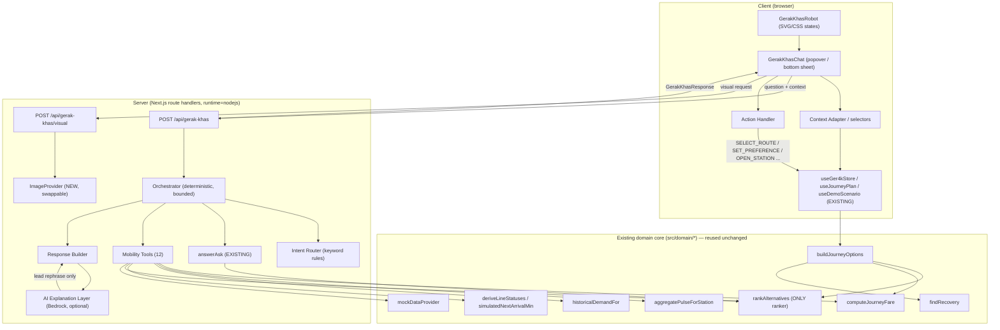
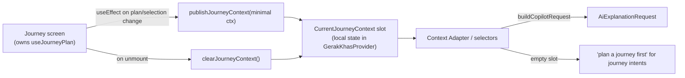
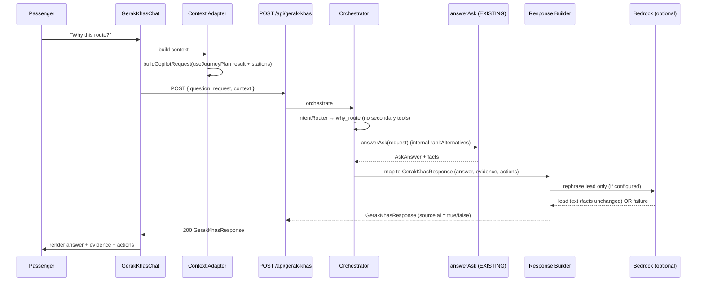
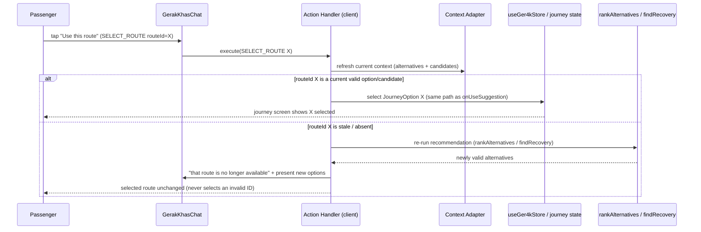
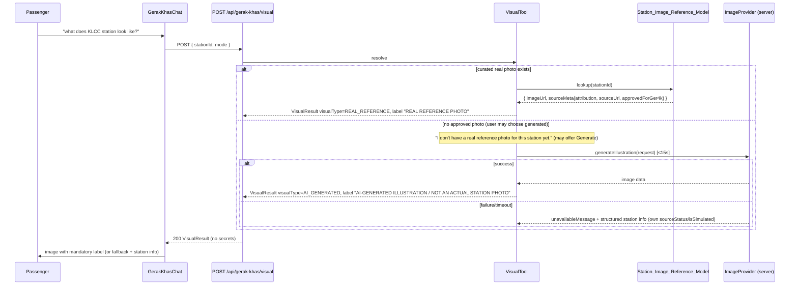

# Design Document

## Overview

Gerak Khas is a contextual mobility co-pilot layered **on top of** the existing GER4K Next.js application. It is an original small robot companion with a compact chat surface that helps Klang Valley passengers understand and act on mobility information: journeys, disruption recovery, stations, Rapid KL buses and the simulated replacement bus, fares, walking, crowding (Station Pulse), service status, accessibility, historical demand, source transparency, and station visuals.

The governing principle is **evidence-before-AI**. Every answer is assembled from existing GER4K domain output first, as a structured `GerakKhasResponse`. Only then does an optional, server-side AI step rephrase the lead sentence. The AI never invents transport facts, never ranks routes, and never computes fares or confidence.

Gerak Khas is a feature-level extension. It reuses the existing GER4K domain modules (`src/domain/*`), the data boundary (`mockDataProvider`), the deterministic Ask GER4K pipeline (`answerAsk`), the AI provider abstraction, the shared store (`Ger4kStore`), and shared types. It does not rebuild GER4K, does not duplicate domain calculations, and does not modify the `ger4k-hackathon-mvp` spec or its completed tasks.

The design keeps the orchestrator **deterministic and bounded**: for each question it classifies exactly one primary intent, issues a fixed finite set of tool calls, assembles the structured response, and (optionally) asks Bedrock to rephrase the lead. It is not an autonomous agent loop. It reuses the proven `/api/ask` thin-handler pattern and adds the smallest possible set of new, thin wrappers.

Constraints honored throughout: React Context + hooks only (no Redux/SWR/TanStack), no agent frameworks, no vector DB/embeddings, no separate backend or database, no new auth, local-only persistence (localStorage). All AI and image calls are server-side so AWS/Bedrock credentials never reach the browser.

---

## Existing Modules Discovered in the Repository

This is the verified inventory Gerak Khas builds on. These modules exist today and are **reused, never duplicated**.

### Domain core (`src/domain/*`) — pure, framework-free, Vitest-testable

| Capability | Module | Entry points (verified) | Notes |
| --- | --- | --- | --- |
| Journey_Planner | `src/domain/transport/journeyPlanner.ts` | `planJourneyOnNetwork(network, originId, destinationId, { blockedSegments? })`; `isNoRouteFound()` guard | Pathfinding only. |
| Recovery_Engine | `src/domain/recovery/recoveryEngine.ts` | `findRecovery` / `findRecoveryOnNetwork` → `RecoveryResult` = `{ ok:true, alternatives }` \| `{ ok:false, reason:"NoAlternativeFound" }`; `generateAlternatives`, `journeyAvoidsBlocked`, `computeBlockedSegments` | Guarantees Alt A / Alt B. |
| Ranking_Engine | `src/domain/recovery/rankingEngine.ts` | `rankAlternatives(journeys, profile): Journey[]`, `rankWithPositions`, `rankingCosts`, `PROFILE_WEIGHTS` | **Only** component permitted to rank/re-rank. Re-exported via `src/domain/recovery` and `src/domain/options`. Profiles: Balanced, Fastest, Cheapest, Least Walking, Fewest Transfers, Avoid Crowding, Accessible. |
| Confidence_Indicator | `src/domain/confidence` | `computeConfidence`, `bandLabel`, `bandMeaning`, `describeFactors` | Reliability band, not a guarantee. |
| Fare_Engine | `src/domain/fare/fareEngine.ts` | `computeJourneyFare(journey, network, rules): JourneyFare { totalSen, items, sourceStatus:"ESTIMATED", isSimulated:false }`; `formatRinggit(sen)` → `"RM4.20"` | Fares are in **sen**. `FareRules` via `provider.getFareRules()`. |
| Pulse_Aggregator | `src/domain/community/pulseAggregator.ts` | `aggregatePulse(stationId, reports, now?)`, `aggregatePulseForStation(provider, stationId, now?): PulseSummary` | `RECENT_WINDOW_MIN=30`, `DOUBLE_WEIGHT_WINDOW_MIN=10`, `HIGH_BAND_MIN_REPORTS=3`; deterministic cautious tie-break toward more severe. Summary carries `sourceStatus:"COMMUNITY_REPORTED"` + `isSimulated`. **Window must not be redefined.** |
| Historical_Demand | `src/domain/demand/historicalDemand.ts` | `historicalDemandFor(dataset, stationId): HistoricalDemand \| null` (band HIGH/MEDIUM/LOW, `sourceStatus:"HISTORICAL"`); `describeDemand()` | Dataset via `provider.getHistoricalDemand()`. |
| Service_Status_Source | `src/domain/service/lineStatus.ts`, `src/domain/service/arrivals.ts` | `deriveLineStatuses(lines, network, ...)`; `simulatedNextArrivalMin(serviceId, headwayMin, ...)` | Line statuses + simulated arrivals. |
| Journey_Options_Engine | `src/domain/options/journeyOptions.ts` | `buildJourneyOptions(input): JourneyOptionsResult { options: JourneyOption[], candidates, profile, mode }` | The real pipeline the journey UI uses. Unions in CORE `findRecovery` (guarantees Alt A / Alt B), relabels simulated legs, enriches fare/crowd/access/confidence, pareto-filters then CORE-ranks. `MAX_PRESENTED=4`. Each `JourneyOption` has `{ id, title, journey, confidence{score,band,factors}, fare{totalSen}, touchStationIds, pathStationIds, hasBus, isSimulated, strategies }`. |
| Personal | `src/domain/personal` | `profileForMobilityNeeds(needs, preferred)`, `MOBILITY_NEEDS`, `evaluateSavedJourneyAlerts` | MobilityNeed → ranking profile mapping. |

### Data boundary

- `src/data/DataProvider.ts` interface; `mockDataProvider` from `@/data`. **Synchronous, in-memory.** Methods: `getStations`, `getNetwork`, `getDisruptions`, `getReports(stationId)`, `submitReport`, `getMultimodalNetwork(opts)`, `getScenarioReports`, `getLineInfo`, `getHistoricalDemand`, `getFareRules`, `restoreReports?`.
- **No station image/photo method. No per-station accessibility/facility dataset.**
- Multimodal fixture `src/data/mock/multimodal.ts`: Rapid KL bus 300 (GTFS-backed, `masjidJamek→klcc`, headway 7), simulated Replacement bus (`TRX→Conlay→persiaranKlcc`, `isSimulated:true`), walk links with `walkMeters`. Exposed via `provider.getMultimodalNetwork({ includeScenarioServices })`.

### Labels (source/simulation truth model)

- `src/types/labels.ts`: `SourceStatus = LIVE | SCHEDULED | OPERATOR_CONFIRMED | COMMUNITY_REPORTED | UNVERIFIED | HISTORICAL | ESTIMATED`; `Labelled { sourceStatus, isSimulated:boolean }`. The two axes are **independent**; a simulated record is never `OPERATOR_CONFIRMED`. `"SIMULATED LIVE DATA"` is UI presentation derived from `isSimulated === true`, never a stored `sourceStatus`.

### Ask GER4K pipeline + AI abstraction

- `src/services/ai/askAnswer.ts`: `answerAsk(req): AskResponse & { effectiveRequest, facts }`; `mapQuestionToIntent(question, stations)` with intents `why_route, why_confidence, avoid_station, cheapest, bus_option, less_walking, accessible, avoid_crowds, fastest, fewest_changes, station_status`. It re-ranks via `rankAlternatives` and **never** computes routes/fares/confidence (they arrive in the request). Pure, framework-free; used by `/api/ask` and as the client offline fallback.
- `src/services/ai/AiProvider.ts`: `AiProvider.explain`, `AiExplanationRequest/Option/Result`, `AskStationContext`. `index.ts`: `isAiConfigured()`, `getAiProvider()`, `BedrockUnavailableError`. `BedrockAiProvider` is `server-only`.
- `src/app/api/ask/route.ts`: thin handler — runs `answerAsk` deterministically, then optionally lets Bedrock rephrase the lead; AI failure never 500s; `runtime="nodejs"`.
- `src/services/ai/buildCopilotRequest.ts`: `buildCopilotRequest(input): AiExplanationRequest | null`; `optionToAsk`; `buildStationContexts(stationIds, stations, pulseByStation, demand, now)`.

### Client state + UI

- `src/components/journey/useJourneyPlan.ts`: `useJourneyPlan(originId, destinationId, profile): JourneyPlan { usual, impact, recovery, disruptions, affecting, result, pulse, stations, now, ready }`. Uses `useDemoScenario()` and `useStationPulse()` from `src/components/state/useLiveData.ts` (`stationName`, `useActiveDisruptions`, `useStationPulse`).
- `src/components/ai/AskGer4kSheet.tsx`: applies a suggestion via `onUseSuggestion(optionId, profile)` — the current path for selecting a route.
- `src/components/state/Ger4kStore.tsx`: `useGer4kStore()` with `preferredProfile`, `mobilityNeeds`, `defaultProfile`, `setPreferredProfile`, `openStation(id, mode)`, `submitReport`, etc. `DemoScenarioProvider` (`useDemoScenario`). Providers mounted in `src/app/layout.tsx`; `AppShell` has `TopBar` + `BottomNavigation`; global `StationSheet` mounted in layout.
- UI primitives: `src/components/ui` (`Sheet`, `Button`, `cn`), `src/components/transit` (`HonestyChip`, `formatRm`, `formatWalk`, `changesText`).

### Testing

- Vitest. Existing tests under `src/**/__tests__` including `src/services/ai/__tests__/askAnswer.test.ts`. **Must keep passing.**

---

## Architecture

Gerak Khas is a thin orchestration layer. The robot/chat UI (client) calls a single new API route; that route reuses the existing deterministic pipeline, gathers extra evidence from mobility tools, assembles a structured response, and optionally rephrases the lead via Bedrock. Actions returned in the response are executed by a client-side handler through existing GER4K state and UI.



Key architectural rules encoded in the diagram:

- **Ordering only from `rankAlternatives`** — either via `answerAsk`'s internal re-rank or via `buildJourneyOptions`. No tool, the orchestrator, or the AI layer re-orders routes.
- **Evidence before AI** — the `GerakKhasResponse` (answer, evidence, actions, routeRecommendation, suggestedPreference, source labels) is fully assembled before the AI layer is consulted; the AI layer may only replace the lead prose.
- **AI only on the server** — the two new route handlers run `runtime="nodejs"`; `BedrockAiProvider` / `BedrockImageProvider` are `server-only`.
- **Actions are data** — navigation/state changes are explicit `GerakKhasAction`s executed by the client action handler, never encoded only in prose.

---

## Components and Interfaces

### Proposed New Modules

All new modules are thin. Nothing here re-implements pathfinding, ranking, fares, confidence, or pulse aggregation.

**UI (`src/components/gerak-khas/`)**

- `GerakKhasProvider.tsx` (NEW) — React Context provider that owns co-pilot UI state: panel open/closed, robot position + docked edge (local client state only, never persisted to server), robot animation state, current conversation messages. It also owns the **current journey context bridge**: a small, serializable `CurrentJourneyContext` slot plus `publishJourneyContext(ctx)` / `clearJourneyContext()`. This is how the globally-mounted companion learns about the page-level journey without duplicating `useJourneyPlan` or moving the journey engine into global state. Mounted once in `layout.tsx` alongside the existing global overlays.
- `GerakKhasRobot.tsx` (NEW) — the original robot, SVG + CSS. Renders the six states; handles Pointer Events drag (desktop) / edge-dock (mobile); exposes Dock Left / Dock Right controls; respects `prefers-reduced-motion`.
- `GerakKhasChat.tsx` (NEW) — the chat surface. Desktop: compact floating popover visually anchored to the robot (≤50% vw, ≤80% vh). Mobile: bottom sheet (≤80% vh initial). Reuses existing `Sheet`, `Button`, input patterns. Hosts the opening message and contextual quick actions.
- `GerakKhasMessage.tsx` (NEW) — renders one `GerakKhasResponse`: answer, evidence chips, warnings, source/simulation labels (reusing `HonestyChip`), embedded actions and visual.
- `GerakKhasActions.tsx` (NEW) — renders the action buttons for a message and calls the client action handler on confirm.
- `GerakKhasVisual.tsx` (NEW) — renders a `VisualResult` with the mandatory real/generated label.

**Services (`src/services/gerak-khas/`)**

- `context/contextAdapter.ts` (NEW) — selectors that build `GerakKhasContext` from existing hooks. Client-side; feeds the request payload.
- `orchestrator.ts` (NEW) — deterministic, bounded pipeline. Runs on the server (inside `/api/gerak-khas`).
- `intentRouter.ts` (NEW) — primary + secondary intent classification by keyword rules, reusing/extending `mapQuestionToIntent`.
- `responseBuilder.ts` (NEW) — maps `AskAnswer` + tool evidence into `GerakKhasResponse`; enforces label independence and the closed action set.
- `actions.ts` (NEW) — `GerakKhasAction` types + the client action handler factory (`createActionHandler(deps)`).
- `tools/` (NEW) — one file per Mobility_Tool (`journeyTool.ts`, `recoveryTool.ts`, `rankingTool.ts`, `stationTool.ts`, `busTool.ts`, `fareTool.ts`, `walkingTool.ts`, `pulseTool.ts`, `serviceStatusTool.ts`, `accessibilityTool.ts`, `historicalDemandTool.ts`, `visualTool.ts`). Deterministic TS services returning JSON-serializable evidence.
- `visual/ImageProvider.ts` (NEW) — the swappable image interface.
- `visual/BedrockImageProvider.ts` (NEW, `server-only`) — one implementation.
- `visual/stationImageReference.ts` (NEW) — `Station_Image_Reference_Model` fixture: curated station images (app-local asset path + required source metadata/attribution). Forbids arbitrary internet images.
- `accessibility/uncertaintyModel.ts` (NEW) — `Accessibility_Uncertainty_Model`: honest-uncertainty-first helper.
- `types.ts` (NEW) — `GerakKhasContext`, `GerakKhasResponse`, `EvidenceItem`, `GerakKhasAction`, `VisualResult`, `MobilityToolResult`.

**API routes**

- `src/app/api/gerak-khas/route.ts` (NEW) — primary endpoint, modeled on `/api/ask`.
- `src/app/api/gerak-khas/visual/route.ts` (NEW) — server-side image generation endpoint.

### Modules Reused Unchanged

These are used exactly as they are; Gerak Khas adds no fork or copy:

- `planJourneyOnNetwork`, `isNoRouteFound`
- `findRecovery` / `findRecoveryOnNetwork`, `journeyAvoidsBlocked`, `computeBlockedSegments`, `generateAlternatives`
- `rankAlternatives`, `rankWithPositions`, `rankingCosts`, `PROFILE_WEIGHTS`
- `computeConfidence`, `bandLabel`, `bandMeaning`, `describeFactors`
- `computeJourneyFare`, `formatRinggit`
- `aggregatePulse`, `aggregatePulseForStation`
- `historicalDemandFor`, `describeDemand`
- `deriveLineStatuses`, `simulatedNextArrivalMin`
- `buildJourneyOptions`
- `profileForMobilityNeeds`, `MOBILITY_NEEDS`
- `mockDataProvider` and the entire `DataProvider` interface
- `answerAsk`, `mapQuestionToIntent`, `buildCopilotRequest`, `optionToAsk`, `buildStationContexts`
- `AiProvider` / `isAiConfigured` / `getAiProvider` / `BedrockAiProvider`
- `useJourneyPlan`, `useGer4kStore`, `useDemoScenario`, `useStationPulse`, `stationName`, `useActiveDisruptions`
- UI primitives: `Sheet`, `Button`, `HonestyChip`, `formatRm`, `formatWalk`, `changesText`

### Companion Character (Robot) Design

An **original** small robot — deliberately not WALL-E / EVE. It is built from SVG shapes animated with CSS transforms/opacity (no physics engine, no heavy animation library), so it is light and testable.

Anatomy (satisfies Requirement 1):

- **Head / visor** — a rounded-rectangle visor with two soft rounded "eyes" (the primary expression surface).
- **Antenna / status light** — a short antenna topped with a glowing dot; its color is the main state channel (amber / red for disruption severity).
- **Body** — a compact, rounded capsule with soft contours.
- **Side modules / arms** — two small rounded side pods (not articulated arms).
- **Base** — a single small wheel or a subtle hovering base (soft shadow).
- **Identity** — a small `G4` / GER4K mark on the chest panel, matching the existing `Ger4kMark` style.

States (Requirement 2), each conveyed by **both** motion (when allowed) and a static indicator (so reduced-motion still reads):

| State | Trigger | Visual | Static fallback |
| --- | --- | --- | --- |
| IDLE | no activity | gentle vertical bob ≤ 6px, slow blink | steady eyes, dim antenna |
| LISTENING | chat input focused | eyes orient toward the chat within 300ms, visor brightens | eyes shifted toward chat, brighter visor |
| THINKING | orchestrator preparing | eyes scan / soft antenna pulse | "thinking" dots in visor |
| SUCCESS | response delivered | one-shot acknowledgement (nod + sparkle) ≤ 1500ms, plays once | brief check glyph in visor |
| DISRUPTION | moderate disruption, no severe | amber antenna indicator | solid amber antenna dot |
| SEVERE | severe disruption (precedence over DISRUPTION) | red status indicator | solid red status dot |

Animation discipline (Req 2.7): states never loop continuously in a way that bounces or interrupts; SUCCESS plays exactly once per delivered response. Under `prefers-reduced-motion` every state is a static indicator (Req 1.4, 2.8).

Movement:

- **Desktop (≥768px)** — draggable via Pointer Events, constrained to the visible viewport; releasing within 48px of an edge docks to that edge; accessible Dock Left / Dock Right controls in the chat panel. No physics, no momentum.
- **Mobile (<768px)** — docked to left or right edge; no unrestricted 2D drag. Optional vertical movement constrained to the current docked edge within viewport bounds. Dock Left / Dock Right controls present. Touch target ≥ 44×44px. Page scrolling unaffected.
- **Position is local client state only** (held in `GerakKhasProvider`), never persisted to any account or server.

### Current Journey Context Bridge (global mount ↔ page-level journey)

Gerak Khas is mounted globally (near `layout.tsx`), but the journey context (origin, destination, selected route, alternatives, `JourneyOptionsResult`) is derived on the **journey screen** via `useJourneyPlan`. The companion must learn that context without re-running the journey engine globally. The smallest clean approach — compatible with the existing React Context + hooks architecture — is a lightweight bridge:

1. **Who publishes** — the journey screen (the component that already calls `useJourneyPlan`). It is the single owner; no second `useJourneyPlan` is created anywhere.
2. **Where it is stored** — a minimal `CurrentJourneyContext` slot held as local React state inside `GerakKhasProvider`. Not Redux, not SWR, not a store library — just provider state.
3. **When it updates** — the journey screen runs a small `useEffect` that calls `publishJourneyContext(ctx)` whenever its plan or selection changes. It publishes only the minimal identifiers/state Gerak Khas needs: `originId`, `destinationId`, `selectedRouteId`, a minimal projection of `result.options` / `result.candidates` (or the `JourneyOptionsResult` itself), the effective `profile`, an active-disruption summary, `stations`, and `now`. It never publishes the whole app state.
4. **When the user leaves** — the journey screen calls `clearJourneyContext()` on unmount, so the slot is emptied and cannot go stale.
5. **No journey in context** — journey-dependent questions return an honest "plan a journey first" response rather than guessing (ties to R10.5). Example: with no journey in context, *"Which route has less walking?"* → Gerak Khas replies that a journey must be planned first. Non-journey questions (*"how crowded is Pasar Seni?"*, station/service/visual) still work from provider/station data without any current journey.



### Context Adapter

A single typed `GerakKhasContext` exposes only what the co-pilot needs. It is derived by focused selectors over the **published `CurrentJourneyContext` slot** (for journey fields) and **existing** provider/store hooks (for station/profile/pulse fields) — it does **not** copy the whole global state and does **not** call `useJourneyPlan` at the global mount point. When the slot is empty, journey-dependent fields are absent and journey intents resolve to the honest "plan a journey first" path.

Derivation map:

| Field | Source | How derived |
| --- | --- | --- |
| `origin`, `destination` | published slot (`originId`, `destinationId`) | current O/D the journey screen published |
| `currentJourney` | published slot projection of `useJourneyPlan().usual` | the usual planned route for the O/D |
| `selectedRoute` | published slot (`selectedRouteId`) + projected `result.options` | currently selected `JourneyOption` (same selection the journey UI tracks) |
| `alternatives` | published slot projection of `result.options` | presented `JourneyOption[]` |
| `candidates` | published slot projection of `result.candidates` | validated but not-presented options (for SELECT_ROUTE validity) |
| `activeDisruption` | published slot active-disruption summary (from `affecting` / `useActiveDisruptions()` + `useDemoScenario().active`) | disruptions affecting the route; severity drives robot DISRUPTION/SEVERE |
| `rankingPreference` | `useGer4kStore().defaultProfile` | effective profile (`profileForMobilityNeeds(mobilityNeeds, preferredProfile)`) |
| `mobilityNeeds` | `useGer4kStore().mobilityNeeds` | for Accessibility routing |
| `selectedStation` | `useGer4kStore()` station sheet state | station currently in focus |
| `relevantPulse` | published slot pulse / `useStationPulse()` | `StationPulseDetail` keyed by station |
| `fareData` | published slot `result.options[*].fare` | already-computed demo fares (ESTIMATED) |
| `walkingData` | published slot `result.options[*].journey.totalWalkMeters` / `touchStationIds` | from existing journey totals + multimodal `walkMeters` |
| `serviceStatus` | derived from `getLineInfo` + `deriveLineStatuses` | line statuses (works without a journey) |
| `stations` | `buildStationContexts(...)` (EXISTING) | per-station `AskStationContext` with `isOKU`, demand band, pulse (works without a journey) |
| `sourceInfo` | each record's own `{ sourceStatus, isSimulated }` | carried verbatim, never collapsed |

The journey fields are read from the published `CurrentJourneyContext` slot; the station/profile/service fields come from provider/store hooks and remain available even when no journey is published. The adapter's primary output is an `AiExplanationRequest` built via the existing `buildCopilotRequest(...)`, plus the raw context needed for tools and actions. This is exactly the payload `/api/gerak-khas` consumes — identical in shape to what `/api/ask` already accepts — so the server reuses `answerAsk` with no changes. When the slot is empty, `buildCopilotRequest` has no journey to describe and journey intents take the honest "plan a journey first" path.

### Intent Router + Constraint Resolution

Deterministic keyword classification (no AI), extending the proven approach in `mapQuestionToIntent`. It returns one **primary intent**, any **secondary intents** that justify additional tool calls, and a small **ConstraintSet**. The tool set per question is **fixed and finite** — no recursion, no autonomous loop.

**Why a separate constraint stage is required.** `mapQuestionToIntent` (verified in `askAnswer.ts`) returns exactly **one** intent on a first-match basis, so a single `answerAsk` call applies **one** profile re-rank and, at most, the `avoid_station` filter. It does **not** natively combine two passenger constraints such as "cheapest" **and** "avoid TRX". To honour compound questions deterministically, the orchestrator runs an explicit constraint-resolution stage **before** ranking:

```
question
  → deterministic intent + ConstraintSet extraction (keyword + station-mention rules)
  → candidate routes (buildJourneyOptions → result.options ++ result.candidates)
  → apply deterministic constraints (FILTER the candidate set)      ← orchestrator, pure
  → valid candidate subset
  → rankAlternatives(subset, requestedProfile)                      ← Ranking_Engine ONLY
  → supporting tools add evidence (fare, pulse, walking, …)
  → responseBuilder
```

`ConstraintSet` (small, serializable, extracted deterministically):

| Field | Extracted from | Effect on the candidate set |
| --- | --- | --- |
| `excludeStationIds: string[]` | existing station-mention detection + "avoid/skip/without" keywords | drop options whose `touchStationIds` include a listed station |
| `requireBus: boolean` | `bus`/`feeder`/`shuttle` keywords | keep only options with `hasBus` |
| `requireAccessiblePreference: boolean` | accessibility keywords (grandmother, wheelchair, OKU, …) | apply the `Accessible` profile and surface `isOKU` evidence |

Rules:

- Filtering candidates on **explicit passenger constraints** happens in the orchestrator (pure, deterministic) **before** ranking. The LLM never filters and never ranks.
- Ordering is performed **only** by `rankAlternatives` (the existing Ranking_Engine) under the requested profile. The orchestrator never sorts by cost itself.
- Bounded and finite: one constraint extraction + one filter + one rank + a fixed supporting-tool set. No recursion, no autonomous agent loop.

Worked constraint examples:

- "cheapest that avoids TRX" → `excludeStationIds: [TRX]`; profile `Cheapest`. Filter out TRX-touching options, then `rankAlternatives(remaining, "Cheapest")`.
- "bus option with less walking" → `requireBus: true`; profile `Least Walking`. Keep `hasBus` options, then `rankAlternatives(remaining, "Least Walking")`.
- "easiest route for my grandmother" → `requireAccessiblePreference: true`; profile `Accessible`; surface `isOKU` evidence; never invent accessibility facilities.

The per-intent tool mapping is unchanged:

Primary intents → tools:

| Intent | Primary tool(s) | Typical secondary tools |
| --- | --- | --- |
| journey | JourneyTool | — |
| recovery | RecoveryTool | RankingTool |
| recommendation | RankingTool | FareTool / WalkingTool (for the comparison line) |
| station | StationTool | PulseTool |
| bus | BusTool | WalkingTool, FareTool, RankingTool |
| fare | FareTool | RankingTool |
| walking | WalkingTool | RankingTool |
| crowding | PulseTool | RankingTool |
| service | ServiceStatusTool | — |
| accessibility | AccessibilityTool | WalkingTool, RankingTool |
| historical demand | HistoricalDemandTool | — |
| visual | VisualTool | StationTool |

Worked multi-tool examples (constraint filter happens before `rankAlternatives`):

- "cheapest option that avoids TRX" → `ConstraintSet { excludeStationIds: [TRX] }`, profile `Cheapest`; tools **FareTool + PulseTool + RankingTool**. The orchestrator filters out TRX-touching candidates, then `rankAlternatives` orders the subset under `Cheapest`; FareTool/PulseTool add evidence only.
- "bus that's cheaper with less walking" → `ConstraintSet { requireBus: true }`, profile `Least Walking`; tools **BusTool + FareTool + WalkingTool + RankingTool**.
- "easiest route for my grandmother" → `ConstraintSet { requireAccessiblePreference: true }`, profile `Accessible`; tools **AccessibilityTool + WalkingTool + RankingTool**.

Determinism (Req 11.6): identical question text + identical context → identical primary intent + identical `ConstraintSet` + identical tool set. This is a pure function, unit-tested.

### Mobility Tools

Every tool is a deterministic TS service returning JSON-serializable `MobilityToolResult` evidence (`{ sourceStatus, isSimulated }` carried on each item, never collapsed). None recompute ranking, fares, confidence, or walking distances independently (Req 8.4).

| Tool | Existing module/data reused | New code | Inputs | Outputs | sourceStatus | isSimulated | Unavailable behavior |
| --- | --- | --- | --- | --- | --- | --- | --- |
| **JourneyTool** | `buildJourneyOptions` / `planJourneyOnNetwork` | thin wrapper | O/D, profile, context | usual journey + options metrics | per-leg (SCHEDULED/UNVERIFIED/ESTIMATED) | from legs | "no route to that destination" |
| **RecoveryTool** | `findRecovery`, `buildJourneyOptions` (recovery mode) | thin wrapper | O/D, disruptions | alternatives incl. Alt A/B/C | per-option | per-option | "no recovery alternative found" (`reason:"NoAlternativeFound"`) |
| **RankingTool** | `rankAlternatives` | thin wrapper | journeys + profile | ordered journeys | passthrough | passthrough | empty input → empty order |
| **StationTool** | `getStations`, `buildStationContexts` | thin wrapper | stationId | station context (name, condition, isOKU, demand) | per-field | per-field | "station not recognised" |
| **BusTool** | `getMultimodalNetwork({includeScenarioServices})`, `simulatedNextArrivalMin` | thin wrapper | journey/context | bus-supported options from the real fixtures: **Rapid KL bus 300** (normal days) and the **Replacement bus** (simulated recovery option C during the demo disruption) | SCHEDULED (bus 300) / UNVERIFIED (Replacement bus) | bus 300 **false**, Replacement bus **true** | "no bus option for this journey" |
| **FareTool** | `computeJourneyFare`, `getFareRules`, `formatRinggit` | thin wrapper | journey + network | total in RM (from sen) | **ESTIMATED** (always) | false (always) | "cannot estimate fare — missing `<input>`" |
| **WalkingTool** | `getMultimodalNetwork` `walkMeters` + option totals | thin wrapper | options | total walking metres per option | ESTIMATED (walk legs) | from legs | "no walking info" |
| **PulseTool** | `aggregatePulseForStation` | thin wrapper | provider, stationId, now | `PulseSummary` (30-min window, recency weight) | **COMMUNITY_REPORTED** | true if any recent report simulated | "no recent reports for that station" |
| **ServiceStatusTool** | `deriveLineStatuses`, `getLineInfo`, `simulatedNextArrivalMin` | thin wrapper | lineId | line status + arrival | per-status | per-status (sim disruption → true) | "no service status for that line" |
| **AccessibilityTool** | `profileForMobilityNeeds`, `AskStationContext.isOKU` | **NEW** `Accessibility_Uncertainty_Model` | stationId, mobilityNeeds | Accessible preference + isOKU flag + explicit uncertainty | UNVERIFIED | false | honest-uncertainty by default: "verified lift/escalator/facility status is not available; check signage" |
| **HistoricalDemandTool** | `historicalDemandFor`, `getHistoricalDemand`, `describeDemand` | thin wrapper | stationId | demand band | **HISTORICAL** | false | "no historical demand data for that station" |
| **VisualTool** | — | **NEW** `ImageProvider` + `Station_Image_Reference_Model` | stationId, mode | `VisualResult` (carries `visualType`, never a transport `sourceStatus`/`isSimulated`) | n/a — image provenance is `visualType` only | n/a — see `visualType` | curated REAL_REFERENCE preferred; else AI_GENERATED; if no approved photo: `"I don't have a real reference photo for this station yet."` (may offer Generate); on failure the graceful fallback message |

The `AccessibilityTool` is honest-uncertainty-first: it surfaces the Accessible ranking preference and the GTFS `isOKU` flag where present, and always states that verified live lift/escalator/facility status is unavailable (Req 24). It never claims an existing accessibility engine or verified dataset.

The `BusTool` answers "Is there a bus option?" from the **actual** multimodal fixtures in `src/data/mock/multimodal.ts` — never an invented service. There is **no MRT feeder** (e.g. no "T508") in the data, so the tool never uses "feeder" language. It returns the relevant bus-supported alternative:

- **Rapid KL bus 300** — an official GTFS-backed Rapid KL *bus* (not an MRT feeder), `masjidJamek → klcc`, ~7-min headway, `sourceStatus = SCHEDULED`, `isSimulated = false`. This is the everyday bus option.
- **Replacement bus** — the simulated disruption-recovery bridging service (`TRX → Conlay → persiaranKlcc`), scenario-only (`getMultimodalNetwork({ includeScenarioServices })`), `isSimulated = true`; the UI may show the `"SIMULATED LIVE DATA"` chip. This is recovery **option C** during the demo disruption.

If no genuine bus-supported option exists for the journey, the tool says "no bus option for this journey" (or names the "replacement bus" when that is the recovery service) — never "MRT feeder".

### Orchestrator

Pure, deterministic, bounded. On the server:

1. Validate the request payload (same validators as `/api/ask`, extended for the extra context the tools need).
2. `intentRouter` → primary intent + secondary intents + `ConstraintSet` + fixed tool set.
3. Build the `AiExplanationRequest` (already provided by the client adapter via `buildCopilotRequest`).
4. **Constraint resolution** — apply the `ConstraintSet` to the candidate pool (`result.options ++ result.candidates`): drop options touching `excludeStationIds`, keep only `hasBus` options when `requireBus`, and select the `Accessible` profile when `requireAccessiblePreference`. This filtering is pure and deterministic; it never sorts.
5. Run `answerAsk(request)` on the constrained pool → `AskAnswer` + `effectiveRequest` + `facts`. This is where **all route ordering** happens (via its internal `rankAlternatives` re-rank) under the requested profile. The orchestrator never re-orders and never sorts by cost itself.
6. Invoke the fixed tool set to gather additional `EvidenceItem`s (fare, pulse, walking, bus, historical demand, service, accessibility).
7. `responseBuilder` maps `AskAnswer` (title/lead/bullets/metrics/suggestion/followUps/reranked) + evidence into a `GerakKhasResponse` (answer, evidence[], source, isSimulated, routeRecommendation, suggestedPreference, actions[], visual, confidence, warnings). Actions are derived here from the closed set.
8. If `isAiConfigured()`, call the AI_Explanation_Layer to rephrase **only** the lead; everything else stays byte-for-byte. On any failure, keep the deterministic lead and set `source` to a non-AI origin. Never 500.

Deterministic fallback = steps 1–7 with no AI. The response always has a non-empty `answer` (fallback message if empty, Req 9.6).

### API Routes

`POST /api/gerak-khas` (modeled on `/api/ask`): `runtime="nodejs"`. Deterministic first, optional Bedrock rephrase, never 500 on AI failure, server-only credentials, no `NEXT_PUBLIC` secrets. Returns `GerakKhasResponse`.

`POST /api/gerak-khas/visual`: validates the request (which carries the requested `mode: "real" | "generated"`). For a real request it returns the curated `Station_Image_Reference_Model` entry as a `VisualResult` with `visualType = REAL_REFERENCE`; if no approved photo exists it returns the exact `"I don't have a real reference photo for this station yet."` message (and may offer a generate action). For a generated request it invokes the server-side `ImageProvider` with a 15-second budget and returns `visualType = AI_GENERATED`. The returned `VisualResult` carries image provenance only via `visualType` — never a transport `sourceStatus`/`isSimulated`. It is a safe payload (no secrets, no provider internals). On failure or timeout it returns the exact fallback message and the structured station info (which keeps its own transport labels) so planning/recovery are never blocked.

---

## Data Models

```typescript
// src/services/gerak-khas/types.ts

/**
 * The minimal, serializable journey slot the journey screen PUBLISHES into
 * GerakKhasProvider. It is NOT the whole app state and NOT a second
 * useJourneyPlan — just the identifiers/projection Gerak Khas needs.
 * Absent (undefined) when no journey is in context.
 */
export interface CurrentJourneyContext {
  originId: string;
  destinationId: string;
  selectedRouteId?: string | null;
  result: JourneyOptionsResult;        // or a minimal projection of options/candidates
  profile: PreferenceProfile;
  activeDisruption?: DisruptionSummary | null;
  stations: AskStationContext[];
  now: number;
}

/** Provider bridge API (local client React state, no store library). */
export interface JourneyContextBridge {
  current: CurrentJourneyContext | null;
  publishJourneyContext(ctx: CurrentJourneyContext): void;
  clearJourneyContext(): void;
}

/**
 * Context the co-pilot needs — built by the adapter from the published
 * CurrentJourneyContext slot (journey fields) plus existing provider/store
 * hooks (station/profile/service fields). Journey fields are optional so the
 * adapter can represent "no journey in context".
 */
export interface GerakKhasContext {
  origin?: StationRef;
  destination?: StationRef;
  currentJourney?: Journey | null;
  selectedRoute?: JourneyOption | null;
  alternatives: JourneyOption[];       // empty when no journey is published
  candidates: JourneyOption[];         // empty when no journey is published
  activeDisruption?: DisruptionSummary | null;
  rankingPreference: PreferenceProfile;
  mobilityNeeds: MobilityNeed[];
  selectedStation?: string | null;
  relevantPulse?: Record<string, StationPulseDetail>;
  stations: AskStationContext[];       // from buildStationContexts (EXISTING)
  request: AiExplanationRequest | null; // from buildCopilotRequest (EXISTING); null when no journey
  hasJourney: boolean;                  // false → journey intents take the "plan a journey first" path
  now: number;
}

/** One piece of evidence. Both label axes are ALWAYS separate. */
export interface EvidenceItem {
  tool: MobilityToolName;
  label: string;
  value: string;                 // human-readable value, already formatted
  sourceStatus: SourceStatus;    // independent axis 1
  isSimulated: boolean;          // independent axis 2
  stationId?: string;
  routeId?: string;
}

/**
 * Deterministic constraints extracted by the intent router for compound
 * questions. The orchestrator filters the candidate set on these BEFORE
 * rankAlternatives. The LLM never fills this in and never filters.
 */
export interface ConstraintSet {
  excludeStationIds: string[];          // "avoid TRX" → drop options touching these
  requireBus: boolean;                  // "bus option" → keep only hasBus options
  requireAccessiblePreference: boolean; // "for my grandmother" → Accessible profile
}

export type GerakKhasActionType =
  | "SELECT_ROUTE" | "SET_PREFERENCE" | "OPEN_STATION" | "OPEN_PULSE"
  | "SHOW_SERVICE" | "SHOW_BUS" | "SHOW_VISUAL" | "REPORT_CONDITION";

export type GerakKhasAction =
  | { type: "SELECT_ROUTE"; routeId: string; profile?: PreferenceProfile }
  | { type: "SET_PREFERENCE"; preference: PreferenceProfile }
  | { type: "OPEN_STATION"; stationId: string }
  | { type: "OPEN_PULSE"; stationId?: string }
  | { type: "SHOW_SERVICE"; lineId: string }
  | { type: "SHOW_BUS"; routeId: string }
  | { type: "SHOW_VISUAL"; stationId: string; mode: "real" | "generated" }
  | { type: "REPORT_CONDITION"; stationId: string };

/**
 * Visual provenance is its OWN axis, independent of the transport
 * source/isSimulated model. An AI-generated image is NOT "simulated mobility
 * data" — `isSimulated` is reserved for simulated transport/operational
 * records only. A VisualResult therefore carries NEITHER `sourceStatus` NOR
 * `isSimulated`; image provenance is expressed solely by `visualType`.
 */
export type VisualType = "REAL_REFERENCE" | "AI_GENERATED";

export interface VisualResult {
  visualType: VisualType;
  stationId: string;
  imageUrl?: string;   // app-local asset for REAL_REFERENCE
  imageData?: string;  // base64/data URL for AI_GENERATED
  label:
    | "REAL REFERENCE PHOTO"
    | "AI-GENERATED ILLUSTRATION / NOT AN ACTUAL STATION PHOTO";
  sourceMeta?: { attribution: string; sourceUrl?: string; approvedForGer4k: true };
  unavailableMessage?: string;   // the exact graceful-fallback text
}

export interface GerakKhasResponse {
  answer: string;                // ≤ 400 chars, leads with the action
  evidence?: EvidenceItem[];
  source?: { ai: boolean; note?: string }; // ai=false for deterministic/fallback
  isSimulated?: boolean;         // top-level convenience; per-value lives on evidence
  routeRecommendation?: { routeId: string; title: string };
  suggestedPreference?: PreferenceProfile;
  actions?: GerakKhasAction[];
  visual?: VisualResult;
  confidence?: { band: ConfidenceBand; meaning: string };
  warnings?: string[];           // honest-uncertainty messages land here
}
```

**VisualResult rules (image provenance is independent of transport labels):**

- `REAL_REFERENCE` → `label = "REAL REFERENCE PHOTO"` and **requires** `sourceMeta` (`attribution`; `sourceUrl` where available; `approvedForGer4k: true`).
- `AI_GENERATED` → `label = "AI-GENERATED ILLUSTRATION / NOT AN ACTUAL STATION PHOTO"`.
- A `VisualResult` does **not** carry `sourceStatus` or `isSimulated` for the image itself. The image is never forced into a transport `SourceStatus` just to satisfy the generic label model; image-generation provenance is represented **only** by `visualType`. An AI-generated image is not "simulated mobility data".
- Transport facts shown **alongside** a visual (station name, pulse, historical demand, fare, etc.) continue to carry their own independent `sourceStatus` + `isSimulated` via their `EvidenceItem`s — unchanged.

Mapping from the existing `AskAnswer` → `GerakKhasResponse` (performed by `responseBuilder`):

- `AskAnswer.title` + `AskAnswer.lead` → `answer` (truncated/led per Req 13.1).
- `AskAnswer.suggestion` → `routeRecommendation` + a single `SELECT_ROUTE` action.
- `AskReranked.profile` (from `answerAsk`) → `suggestedPreference` + a single `SET_PREFERENCE` action.
- `AskAnswer.metrics` / `bullets` → `EvidenceItem[]` (plus tool evidence).
- `AskAnswer.stationId` → `OPEN_STATION` / `OPEN_PULSE` action for station/crowding intents.
- Honest-uncertainty (no tool data) → `warnings` + an answer that says reliable info is not available.

---

## Data Flow

### Normal chat request



### Multi-tool request

```mermaid
sequenceDiagram
    participant U as Passenger
    participant Chat as GerakKhasChat
    participant API as POST /api/gerak-khas
    participant Orc as Orchestrator
    participant IR as Intent Router
    participant Ask as answerAsk
    participant Fare as FareTool
    participant Pulse as PulseTool
    participant RB as Response Builder

    U->>Chat: "cheapest option that avoids TRX"
    Chat->>API: POST { question, request, context }
    API->>Orc: orchestrate
    Orc->>IR: classify
    IR-->>Orc: primary=fare; ConstraintSet{excludeStationIds:[TRX]}; profile=Cheapest; tools={Fare, Pulse, Ranking}
    Orc->>Orc: constraint filter — drop candidates touching TRX (pure, no sort)
    Orc->>Ask: answerAsk on constrained pool (Cheapest re-rank via rankAlternatives)
    Ask-->>Orc: AskAnswer (ordered)
    Orc->>Fare: fare for recommended option
    Orc->>Pulse: aggregatePulseForStation(TRX)
    Fare-->>Orc: EvidenceItem ESTIMATED
    Pulse-->>Orc: EvidenceItem COMMUNITY_REPORTED + isSimulated
    Orc->>RB: merge AskAnswer + evidence → GerakKhasResponse
    RB-->>API: response (SELECT_ROUTE + fare/pulse evidence)
    API-->>Chat: 200
    Chat->>U: ranked cheapest route, fare labelled ESTIMATED, TRX crowding noted
```

Constraint filtering (drop TRX-touching candidates) is a pure orchestrator step that runs **before** ranking; ordering then comes only from `answerAsk`'s `rankAlternatives` re-rank. FareTool and PulseTool contribute evidence, never order.

### Route-changing action (incl. stale-route rejection)



`SET_PREFERENCE` follows the same pattern but calls `useGer4kStore.setPreferredProfile`, which triggers the existing engine re-rank. `OPEN_STATION`/`OPEN_PULSE` call `openStation(id, mode)` / navigate to Pulse. `SHOW_SERVICE` opens service detail. `SHOW_BUS` selects/shows the bus-supported option — Rapid KL bus 300 on normal days, or the simulated Replacement bus as recovery option C during the demo disruption. `REPORT_CONDITION` opens the station sheet in `"report"` mode (`submitReport`).

### Station visual request (real vs generated)



A curated factual image is always preferred over a generated one (Req 27.3). A generated image is always labelled as an approximation (`visualType = AI_GENERATED`, Req 27.6–27.7) and never as a real photo. Image provenance travels on `visualType` alone; any transport facts rendered beside the image keep their own `sourceStatus` + `isSimulated`.

**Real-reference-photo scope (hackathon).** The `Station_Image_Reference_Model` is not a large image database. It starts by curating only a few demo stations — **Putrajaya Sentral, TRX, Pasar Seni, and KLCC** (KLCC only if a suitable approved source is available). Every real image requires source/attribution metadata (`approvedForGer4k: true`), which forbids arbitrary internet images. When no approved image exists for a station, Gerak Khas says exactly: `"I don't have a real reference photo for this station yet."` and MAY offer a `[Generate an illustration]` action; any generated illustration carries the mandatory `"AI-GENERATED ILLUSTRATION / NOT AN ACTUAL STATION PHOTO"` label (`visualType = AI_GENERATED`).

---

## Source / isSimulated Handling

The two axes defined in `src/types/labels.ts` stay **independent** end to end. Neither is ever derived from the other, and neither is ever collapsed into a single value.

Propagation:

1. **Origin** — each domain record already carries `{ sourceStatus, isSimulated }` (fares ESTIMATED/false; pulse COMMUNITY_REPORTED/variable; historical HISTORICAL/false; simulated services UNVERIFIED/true; scheduled rail SCHEDULED/false).
2. **Tools** — each `EvidenceItem` copies both axes verbatim from the record it describes. Tools never invent or merge labels.
3. **Response** — `GerakKhasResponse.evidence[]` carries both axes per item; `source` describes AI vs non-AI origin (a third, separate concept). **Visuals are a fourth, separate concern:** a `VisualResult` carries no `sourceStatus` and no `isSimulated`; image provenance is expressed only by `visualType` (`REAL_REFERENCE` / `AI_GENERATED`). An AI-generated image is never treated as "simulated mobility data". Any transport facts shown next to a visual keep their own two axes via their `EvidenceItem`s.
4. **UI** — `GerakKhasMessage` renders the `sourceStatus` value directly and, **separately**, when `isSimulated === true`, shows the `"SIMULATED LIVE DATA"` chip (reusing the existing `HonestyChip` "simulated" tone) adjacent to the value. ESTIMATED fares show `"ESTIMATED"` / `"DEMO FARE ESTIMATE"`. Unverified accessibility shows an explicit uncertainty statement. Historical demand shows a `"historical data"` label. A visual shows its `visualType` label (`"REAL REFERENCE PHOTO"` or `"AI-GENERATED ILLUSTRATION / NOT AN ACTUAL STATION PHOTO"`) — this is distinct from any transport chip on accompanying evidence.

`"SIMULATED LIVE DATA"` is only ever presentation derived from `isSimulated === true` plus the relevant `SourceStatus` — it is never stored as a `SourceStatus`.

---

## Error Handling

### Failure / Fallback Behavior

| Failure | Behavior |
| --- | --- |
| **AI provider down** (Bedrock unreachable, no internet, model error, missing credentials, quota) | `/api/gerak-khas` returns the fully-assembled deterministic `GerakKhasResponse` (`answerAsk` + tools), `source.ai = false`. Never 500 (Req 16). |
| **AI rephrase throws mid-request** | Keep the deterministic lead; `source.ai = false`. Never 500. |
| **Image provider down / >15s** | `/api/gerak-khas/visual` returns the exact message `"I couldn't generate the illustration right now, but I can still show the station information I have."` plus the structured station info. Planning/recovery never blocked (Req 29). |
| **No route** (`isNoRouteFound`) | `answer` states no route to that destination; `warnings` records it; no fabricated route. |
| **No recovery** (`reason:"NoAlternativeFound"`) | `answer` states no recovery alternative; no fabricated alternative. |
| **Unknown station** | Tool returns "station not recognised"; `answer` states it; `warnings` records it. |
| **No recent pulse reports** | "no recent reports for that station" (30-min window unchanged). |
| **Missing fare input** | "cannot estimate fare — missing `<input>`". |
| **No tool supports the fact** | `answer` states reliable info is not available; `warnings` records the uncertainty; AI content is never substituted for missing structured data (Req 26). |
| **Journey intent with no journey in context** | Empty `CurrentJourneyContext` slot → journey-dependent questions (e.g. "Which route has less walking?") return an honest "plan a journey first" response, never a guess (R10.5). Non-journey questions (crowding/station/service/visual) still answer from provider/station data. |
| **Empty assembled answer** | Orchestrator sets `answer` to a fallback "no answer available" message (Req 9.6). |
| **Stale SELECT_ROUTE** | Rejected; context refreshed; recommendation re-run via `rankAlternatives`/`findRecovery`; new valid alternatives presented; selected route never changed to an invalid ID (Req 14.5). |
| **Invalid request payload** | `400 { error, field }` (same validators as `/api/ask`). |

Security: both routes run server-side; `BedrockAiProvider` / `BedrockImageProvider` are `server-only`; responses contain only result data with every provider credential omitted; no secret is placed in any `NEXT_PUBLIC_` variable (Req 18, 28).

---

## Testing Strategy

Vitest, matching the existing pattern (`src/**/__tests__`, `src/services/ai/__tests__/askAnswer.test.ts`). The co-pilot is almost entirely pure/deterministic, so the bulk is fast unit tests with example-based and edge-case coverage. There are no property-based tests: the new logic is UI rendering, deterministic keyword routing, side-effect wiring over existing engines, and image/accessibility uncertainty wrappers — all better served by example/edge/snapshot/mock tests than by "for all inputs" properties. All route ordering, fares, confidence, and pulse aggregation are covered by the **existing** domain tests, which must keep passing.

Test coverage (each a focused automated test, Req 30):

- **Character state logic** — pure state resolver: IDLE/LISTENING/THINKING/SUCCESS/DISRUPTION/SEVERE, SEVERE precedence over DISRUPTION, SUCCESS-plays-once. (Reduced-motion is asserted at the class/attribute level; see risks.)
- **Context adapter** — each `GerakKhasContext` field derives from the right existing hook output; the whole global state is not copied.
- **Intent routing + constraint extraction** — primary intent and `ConstraintSet` for representative questions; determinism (same text + context → same intent + same `ConstraintSet` + same tool set).
- **Constraint resolution** — "cheapest that avoids TRX" drops TRX-touching candidates before `rankAlternatives`; "bus with less walking" keeps only `hasBus` candidates; "easiest for my grandmother" selects `Accessible`. Asserts the orchestrator filters but never sorts, and ordering comes only from `rankAlternatives`.
- **Current journey context bridge** — `publishJourneyContext`/`clearJourneyContext` update the slot; a journey intent with an empty slot (e.g. "Which route has less walking?") returns the honest "plan a journey first" response, while a non-journey question (crowding/station/service/visual) still answers from provider/station data.
- **Multi-tool routing** — the worked examples resolve to the expected fixed tool sets.
- **Deterministic fallback** — with AI disabled, the response is fully formed, `source.ai = false`, and stable across repeated identical requests.
- **Bus / fare / walking / crowding questions** — correct tool invoked, correct labels (bus 300 not simulated, Replacement bus simulated; fare ESTIMATED; pulse 30-min window; walking in metres).
- **Accessibility uncertainty** — AccessibilityTool surfaces the Accessible preference + `isOKU`, states verified facility status unavailable, never claims an engine/dataset.
- **Unsupported facts** — honest-uncertainty response, `warnings` populated, no AI-substituted fact.
- **Source / isSimulated preservation** — fails if any `GerakKhasResponse`, tool output, or `EvidenceItem` collapses the two axes into one.
- **Valid route selection** — SELECT_ROUTE references only a current alternative/candidate; executing it selects the existing `JourneyOption`.
- **Stale route rejection** — fails if SELECT_ROUTE references an ID absent from current alternatives and candidates; the handler re-runs recommendation and never selects an invalid ID.
- **Image real-vs-generated labelling** — fails if an `AI_GENERATED` visual is labelled as a real photo; `REAL_REFERENCE` visuals carry `sourceMeta` (attribution + `approvedForGer4k`). Also asserts a `VisualResult` carries **no** `sourceStatus`/`isSimulated` (image provenance is `visualType` only), while any transport evidence beside it keeps its own two axes.
- **Real-photo scope / missing photo** — a station without a curated approved image returns exactly `"I don't have a real reference photo for this station yet."` and may offer a Generate action; curated set limited to the demo stations (Putrajaya Sentral, TRX, Pasar Seni, KLCC-if-approved).
- **Image-provider failure** — fails if structured station info is omitted when generation fails/times out; the exact fallback message is returned.

The combined Gerak Khas + existing GER4K suite must pass with zero failing tests (Req 30.6).

---

## Requirements That Cannot Be Implemented Cleanly With the Current Architecture

Being honest about the gaps, per the requirements' own framing:

1. **No per-station accessibility / facility dataset.** The repo has only a MobilityNeed → profile mapping and the GTFS `isOKU` flag. Verified live lift/escalator/facility status simply does not exist and cannot be fabricated. The `Accessibility_Uncertainty_Model` is therefore honest-uncertainty-first by design (Req 24): it surfaces the Accessible preference and `isOKU` where present and states that verified facility status is unavailable. This is a deliberate, requirement-approved limitation, not a shortfall.
2. **No station image data.** `DataProvider` has no image method. This is intentionally **not** a large image database for the hackathon: real reference photos are limited to a small curated set in the new `Station_Image_Reference_Model` fixture — starting with Putrajaya Sentral, TRX, Pasar Seni, and KLCC (if a suitable approved source exists) — each with required attribution metadata (`approvedForGer4k: true`). A station without a curated approved image gets exactly `"I don't have a real reference photo for this station yet."` and may offer an AI illustration (always labelled `AI_GENERATED`). Coverage of "real" photos is only as broad as this curated fixture.
3. **`prefers-reduced-motion` testing limits.** We can unit-test that the robot renders the static-indicator variant (class/attribute) under the reduced-motion branch, but we cannot assert the *absence of visual motion* in jsdom. True verification needs manual/visual checking — automated coverage here is structural only.
4. **Timing-based animation guarantees** (300ms LISTENING orient, ≤1500ms SUCCESS, ≤6px bob) are expressed as CSS transition/transform values and asserted structurally; exact runtime timing is not asserted in unit tests.
5. **Image generation latency** depends on Bedrock. The 15-second budget and graceful fallback make this non-blocking, but a working "generated" demo depends on live Bedrock availability; the real-photo and deterministic paths remain fully functional offline.

None of these block the core co-pilot: journey, recovery, ranking, bus, fare, walking, crowding, service, historical demand, source transparency, and deterministic fallback are all fully implementable over the existing, verified domain modules.

---

## Technical Risks

| Risk | Impact | Mitigation |
| --- | --- | --- |
| Context drift between client selection and server evidence | A SELECT_ROUTE could reference a stale option | Stale-route rejection flow: refresh context, re-run via `rankAlternatives`/`findRecovery`, present valid options, never select an invalid ID (Req 14.5). |
| Accidental re-ranking outside the Ranking_Engine | Violates the "only ranker" rule | Orchestrator and tools never sort by cost; ordering comes only from `answerAsk`/`buildJourneyOptions` (both use `rankAlternatives`). Enforced by code review + tests. |
| Collapsing the two label axes in new response types | Violates source/simulation independence | `EvidenceItem`/`VisualResult`/response always carry both fields separately; a dedicated test fails on collapse (Req 30.3). |
| Robot/chat obscuring GER4K nav or blocking scroll | Breaks non-replacement guarantee | Mounted as overlay with pointer-events scoped to the robot/panel; chat is a bounded popover/sheet; page scroll untouched; nav stays interactive (Req 7). |
| AI or image provider failures surfacing as errors | Broken demo | Thin-handler pattern: deterministic first, AI/image strictly optional, never 500, exact graceful fallback messages (Req 16, 29). |
| Secret leakage to the client | Security breach | Server-only providers, `runtime="nodejs"`, responses stripped of credentials, no `NEXT_PUBLIC_` secrets (Req 18, 28). |
| Breaking existing GER4K tests | Regression | Reuse-only approach; no edits to existing domain/spec; combined suite gate (Req 30.6). |
| Scope creep into an agent framework | Violates constraints | Bounded, finite tool set per question; deterministic intent router; no recursion, no LangChain/vector DB/embeddings. |
