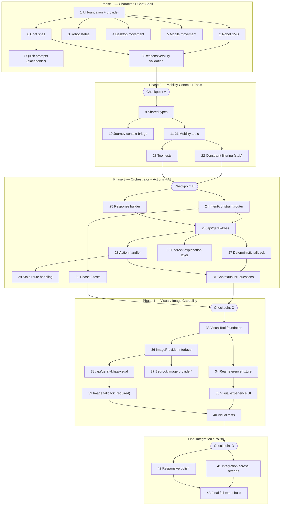

# Implementation Plan: Gerak Khas

## Overview

Gerak Khas is a feature-level extension of the existing GER4K Next.js app: an original robot companion with a compact chat surface that answers mobility questions using existing GER4K domain output first (evidence-before-AI). All work reuses the existing domain modules (`planJourneyOnNetwork`, `findRecovery`, `rankAlternatives`, `computeConfidence`, `computeJourneyFare`, `aggregatePulseForStation`, `historicalDemandFor`, `deriveLineStatuses`/`simulatedNextArrivalMin`, `buildJourneyOptions`, `mockDataProvider`, `answerAsk`/`mapQuestionToIntent`/`buildCopilotRequest`/`buildStationContexts`, `AiProvider`/`isAiConfigured`/`getAiProvider`, `useJourneyPlan`, `useGer4kStore`, `useDemoScenario`, `useStationPulse`, and UI primitives `Sheet`/`Button`/`HonestyChip`/`formatRm`/`formatWalk`/`changesText`). It never duplicates domain calculations and never modifies the `ger4k-hackathon-mvp` spec or its completed tasks.

**Phase gating (strict):** Work is organized into four phases, each ending with a CHECKPOINT review gate. Do NOT begin a phase until the previous checkpoint is explicitly approved. The app must remain runnable after every checkpoint, and the existing GER4K test suite must keep passing throughout.

## Phase Gating and Dependency Overview



## Tasks

### Phase 1 — Gerak Khas Character + Chat Shell

- [x] 1. Gerak Khas UI foundation and provider
  - Create the `src/components/gerak-khas/` directory
  - Create `GerakKhasProvider.tsx` owning co-pilot UI state only: panel open/closed, robot position + docked edge (local client state only, never persisted to server), robot animation state, conversation UI messages. No transport reasoning in the provider.
  - Expose a `useGerakKhas()` hook for descendant components
  - Mount the provider once globally in `src/app/layout.tsx` alongside the existing global overlays, WITHOUT removing, disabling, or obscuring any existing GER4K navigation, screen, or overlay (MODIFIES existing file `src/app/layout.tsx`)
  - _Requirements: 5.1, 5.2, 5.3, 7.1, 7.2, 7.3_

- [x] 2. Original Gerak Khas robot character
  - Create `GerakKhasRobot.tsx` rendering the robot as SVG + CSS transforms/opacity (no physics engine, no heavy animation library)
  - Anatomy: rounded-rectangle visor with two soft rounded eyes, short antenna topped with a glowing status dot, compact rounded capsule body with soft contours, two small rounded side modules/arms, a single small wheel or subtle hovering base, and a small `G4`/GER4K chest mark matching `Ger4kMark` style
  - Ensure the design is original and does not reproduce any known copyrighted robot character
  - _Requirements: 1.1, 1.2, 1.3_

- [x] 3. Robot state machine and indicators
  - Add a pure, deterministic state resolver for IDLE, LISTENING, THINKING, SUCCESS, DISRUPTION, SEVERE
  - IDLE bobbing vertical displacement ≤ 6 CSS px; LISTENING orients eyes toward chat within 300ms; THINKING loading/eye animation; SUCCESS one-shot acknowledgement ≤ 1500ms that plays once per delivered response (never continuous)
  - DISRUPTION shows an amber antenna indicator; SEVERE shows a red status indicator and takes precedence over DISRUPTION
  - Respect `prefers-reduced-motion`: suppress non-essential motion and convey each state via a static indicator
  - Implement as a pure resolver plus CSS so motion values are structurally assertable
  - _Requirements: 1.4, 2.1, 2.2, 2.3, 2.4, 2.5, 2.6, 2.7, 2.8_

- [x] 4. Robot movement — desktop
  - Add Pointer Events dragging for Desktop_Width (≥768px), constrained to the visible viewport bounds
  - Dock the robot to a viewport edge when released within the 48px Edge_Dock_Threshold
  - Add accessible Dock Left and Dock Right controls in the chat panel
  - No physics/momentum library; position held as local client state in `GerakKhasProvider`, never persisted to any account or server
  - _Requirements: 3.1, 3.2, 3.3, 3.4, 3.5_

- [x] 5. Robot movement — mobile
  - For Mobile_Width (<768px), dock to left or right edge only; no unrestricted two-axis dragging
  - Support optional vertical movement constrained to the current docked edge within viewport bounds
  - Provide accessible Dock Left and Dock Right controls at Mobile_Width; touch target ≥ 44×44 CSS px
  - Leave normal GER4K page scrolling unaffected by the robot
  - _Requirements: 4.1, 4.2, 4.3, 4.4, 4.5_

- [x] 6. Chat shell
  - Create `GerakKhasChat.tsx`: desktop compact floating popover visually anchored to the robot (≤50% viewport width, ≤80% viewport height); mobile bottom sheet (≤80% viewport height on first open), reusing existing `Sheet` and `Button`
  - Open the panel within 300ms of activating the robot
  - On first open per session, display the exact opening message: `Hi, I'm Gerak Khas 👋 Ask me about your route, stations, buses, fares, walking, crowding or service conditions.`
  - Add a transcript area, a free-text input accepting 1–500 characters, a send button, and a close control
  - Retain typed text and indicate invalid length (and do not submit) when input is empty or exceeds 500 characters
  - _Requirements: 5.1, 5.2, 5.3, 5.4, 5.5, 5.6_

- [x] 7. Contextual quick prompts (placeholder responses)
  - Render quick actions "Why this route?", "Bus alternative", "Less walking", "Avoid crowds", "Fare", and "Station info"
  - In Phase 1, render ONLY the quick-prompt UI with deterministic placeholder responses; use only context already trivially available to the component (if any), and MAY visually demonstrate route-dependent prompts using local/prototype state
  - Do NOT build or depend on the Phase 2 journey context bridge (Task 11); selecting a quick action returns a deterministic placeholder response, and do NOT connect Bedrock or the orchestrator yet
  - For the placeholder/prototype, hide the route-dependent quick actions ("Why this route?", "Bus alternative", "Less walking", "Avoid crowds", "Fare") when no route is represented in local/prototype state; hide any quick action not applicable to the current context
  - The real contextual visibility and behavior of these quick prompts is connected AFTER Task 11 in Phase 2 (the bridge replaces this placeholder/prototype behavior with real context-driven behavior)
  - _Requirements: 6.1, 6.2, 6.3, 6.4_

- [x] 8. Phase 1 responsive and accessibility validation
  - Add structural/automated tests asserting the robot does not block GER4K navigation and the chat does not disable or obscure nav controls (nav remains interactive)
  - Assert chat sizing at desktop (~1280px) and mobile (~390px), keyboard focus reachability, touch targets ≥44px, and the reduced-motion static-indicator branch (class/attribute level)
  - _Requirements: 1.4, 4.4, 4.5, 5.2, 5.3, 7.2, 7.3_

- [x] 9. Checkpoint A — Character Review (review gate)
  - **STOP. Do not proceed to Phase 2 until this checkpoint is approved.**
  - Confirm: GER4K works normally with the companion mounted; the robot is visible and looks like an original character (not WALL-E/EVE); drag + edge-dock works on desktop and edge-dock works on mobile; the chat opens, is responsive, and shows the opening message; placeholder quick prompts work and hide correctly without a route; the existing GER4K test suite passes.

### Phase 2 — Mobility Context + Tools

- [x] 10. Gerak Khas shared types
  - Create `src/services/gerak-khas/types.ts` with `GerakKhasContext`, `CurrentJourneyContext`, `JourneyContextBridge`, `GerakKhasResponse`, `EvidenceItem`, `ConstraintSet`, `GerakKhasAction`/`GerakKhasActionType`, `VisualResult`/`VisualType`, and `MobilityToolResult`
  - Keep `sourceStatus` and `isSimulated` as two independent fields on every evidence/tool output; never collapse them into one value
  - Define `VisualType` as `REAL_REFERENCE | AI_GENERATED`; a `VisualResult` carries neither `sourceStatus` nor `isSimulated` (image provenance is `visualType` only)
  - _Requirements: 8.7, 8.8, 9.1, 9.4, 9.5, 27.8_

- [x] 11. Global journey context bridge
  - Add minimal `publishJourneyContext(ctx)` / `clearJourneyContext()` and a `CurrentJourneyContext` slot (local React state) to `GerakKhasProvider`
  - In the journey screen (MODIFIES existing `src/components/journey/JourneyScreen.tsx`), add a `useEffect` that publishes the minimal context when the plan/selection changes: `originId`, `destinationId`, usual journey projection, `selectedRouteId`, a minimal projection of `result.options`/`result.candidates`, effective profile, active-disruption summary, mobility needs, selected station, relevant pulse, and fare/walking where available; call `clearJourneyContext()` on unmount
  - Do NOT create a second `useJourneyPlan` and do NOT move the journey engine into global state
  - NOTE: This task is what wires real contextual behavior into the Phase 1 quick prompts (Task 7) — Task 7's placeholder/prototype quick-prompt behavior is replaced here with real context-driven behavior once the bridge is publishing live journey context
  - _Requirements: 10.1, 10.2, 10.4, 10.5_

- [x] 12. JourneyTool
  - Create `src/services/gerak-khas/tools/journeyTool.ts` as a thin wrapper over `buildJourneyOptions`/`planJourneyOnNetwork`; return the usual journey + option metrics as JSON-serializable evidence with per-leg `sourceStatus` + `isSimulated`
  - Return "no route to that destination" when `isNoRouteFound`; never duplicate route calculation
  - _Requirements: 8.1, 8.2, 8.4, 8.7, 8.9, 10.1_

- [x] 13. RecoveryTool
  - Create `tools/recoveryTool.ts` wrapping `findRecovery`/`buildJourneyOptions` (recovery mode); surface Alt A, Alt B, and the feeder/bus-supported Alt C
  - Return "no recovery alternative found" on `reason:"NoAlternativeFound"`; never fabricate alternatives
  - _Requirements: 8.1, 8.2, 8.4, 19.1, 31.3, 31.4, 31.5_

- [x] 14. RankingTool
  - Create `tools/rankingTool.ts` wrapping `rankAlternatives` only; support exactly the 7 profiles (Balanced, Fastest, Cheapest, Least Walking, Fewest Transfers, Avoid Crowding, Accessible)
  - The tool never sorts/ranks itself; passthrough labels; empty input → empty order
  - _Requirements: 8.1, 8.4, 8.5, 15.1, 15.4_

- [x] 15. FareTool
  - Create `tools/fareTool.ts` wrapping `computeJourneyFare` + `getFareRules` + `formatRinggit`; return total in RM (from sen), `sourceStatus = ESTIMATED` always, `isSimulated = false` always, with breakdown
  - Return "cannot estimate fare — missing `<input>`" naming the missing input; never invent fares
  - _Requirements: 8.1, 8.2, 8.4, 20.1, 20.2, 20.3, 20.4_

- [x] 16. WalkingTool
  - Create `tools/walkingTool.ts` reading walking distances from existing journey totals and multimodal `walkMeters` via `provider.getMultimodalNetwork`; return total walking metres per option
  - Never invent exits, walkways, lifts, stairs, or crossings; return "no walking info" when unavailable
  - _Requirements: 8.3, 8.4, 21.1, 21.2_

- [x] 17. PulseTool
  - Create `tools/pulseTool.ts` wrapping `aggregatePulseForStation`; preserve the 30-min recent window, 10-min double-recency weighting, and confidence; do NOT implement chatbot-specific aggregation or redefine the window
  - Carry `sourceStatus = COMMUNITY_REPORTED` and the separate `isSimulated` flag; return "no recent reports for that station" when empty
  - _Requirements: 8.1, 8.2, 8.4, 22.1, 22.2, 22.4, 22.7_

- [x] 18. StationTool
  - Create `tools/stationTool.ts` wrapping `getStations`/`buildStationContexts`; return station name, lines/interchange where known, Pulse, historical demand, and the `isOKU` flag where available
  - Return "station not recognised" for unknown stations; unknown facts return unavailable rather than fabricated values
  - _Requirements: 8.1, 8.2, 8.9, 24.5, 25.1_

- [x] 19. BusTool
  - Create `tools/busTool.ts` reading from the actual multimodal fixtures via `provider.getMultimodalNetwork({ includeScenarioServices })`: Rapid KL bus 300 (`SCHEDULED`, `isSimulated=false`) where relevant and the simulated Replacement bus (`UNVERIFIED`, `isSimulated=true`) as recovery option C during the demo disruption; include arrival info from `simulatedNextArrivalMin` where available
  - Do NOT introduce an unverified service (no "T508") and do NOT call Rapid KL buses "MRT feeder"; return "no bus option for this journey" when none exists; "bus options cannot be retrieved" on failure
  - _Requirements: 8.3, 8.4, 19.1, 19.2, 19.3, 19.5, 19.6, 19.7, 31.4_

- [x] 20. ServiceStatusTool
  - Create `tools/serviceStatusTool.ts` wrapping `deriveLineStatuses`, `getLineInfo`, and `simulatedNextArrivalMin`; return line identifier + status with the real `sourceStatus` and separate `isSimulated`
  - Return "no service status for that line" when unavailable
  - _Requirements: 8.1, 8.2, 23.1, 23.2, 23.3, 23.4_

- [x] 21. AccessibilityTool and uncertainty model
  - Create `src/services/gerak-khas/accessibility/uncertaintyModel.ts` (honest-uncertainty-first helper) and `tools/accessibilityTool.ts`
  - Surface the Accessible ranking preference (via `profileForMobilityNeeds`) and the `isOKU` flag where present; report by default that verified lift/escalator/facility status is not available and advise checking signage
  - Never claim an existing accessibility engine or verified dataset; carry `sourceStatus = UNVERIFIED`, `isSimulated = false`
  - _Requirements: 8.6, 24.1, 24.2, 24.3, 24.4, 24.5_

- [x] 22. HistoricalDemandTool
  - Create `tools/historicalDemandTool.ts` wrapping `historicalDemandFor` + `getHistoricalDemand` + `describeDemand`; preserve `sourceStatus = HISTORICAL`; present as typical demand, not live crowding
  - Return "no historical demand data for that station" when absent
  - _Requirements: 8.1, 8.2, 25.1, 25.2, 25.3_

- [x] 23. Deterministic constraint filtering (stub)
  - Add the `ConstraintSet` extraction and candidate-filter stage (stubbed in Phase 2, finalized in Phase 3's intent router): "avoid TRX" drops candidates touching TRX; "bus option" keeps only `hasBus` options; "less walking" selects the Least Walking profile; "cheapest" selects the Cheapest profile
  - Enforce the pipeline candidates → constraints (pure filter, no sort) → subset → `rankAlternatives` → evidence; the LLM never filters or ranks
  - _Requirements: 11.1, 11.2, 11.4, 15.1, 15.4_

- [x] 24. Mobility tool tests
  - In `src/services/gerak-khas/__tests__/`, add focused tests for journey, recovery, ranking, fare, walking, pulse, station, bus, service, accessibility uncertainty, historical demand, multi-tool evidence assembly, constraint filtering, and `sourceStatus`/`isSimulated` separation (test fails if the two axes are collapsed)
  - Assert bus 300 is not simulated and the Replacement bus is simulated; fare is ESTIMATED; pulse uses the 30-min window; walking is in metres
  - _Requirements: 30.1, 30.3_

- [x] 25. Checkpoint B — Mobility Knowledge Review (review gate)
  - **STOP. Do not proceed to Phase 3 until this checkpoint is approved.**
  - Confirm with NO Bedrock: Gerak Khas answers deterministically for Why this route / fastest / cheapest / less walking / avoid TRX / bus option / fare / how crowded is TRX / service status / historical demand / grandmother; evidence carries separate source and simulation labels; the existing GER4K test suite passes.

### Phase 3 — Orchestrator + Actions + Optional AI

- [x] 26. Intent and constraint router
  - Create `src/services/gerak-khas/intentRouter.ts`: deterministic keyword classification (no AI) returning one primary intent, any secondary intents, the `ConstraintSet`, and the requested ranking preference; select a fixed, finite tool set per question (no recursion/autonomous loop)
  - Guarantee determinism: identical question text + identical context → identical primary intent + identical `ConstraintSet` + identical tool set
  - _Requirements: 11.1, 11.2, 11.3, 11.5, 11.6_

- [x] 27. Response builder
  - Create `src/services/gerak-khas/responseBuilder.ts` mapping `AskAnswer` + tool evidence into a `GerakKhasResponse` (answer ≤400 chars leading with the action, evidence[], source, routeRecommendation, suggestedPreference, actions[] from the closed set, confidence, warnings)
  - Populate evidence/source/routeRecommendation/suggestedPreference/actions from tool evidence before any AI language; set a fallback `answer` when empty; carry each value's `sourceStatus` and separate `isSimulated` in `source`/`warnings`
  - _Requirements: 9.1, 9.3, 9.4, 9.5, 9.6, 12.1, 13.1_

- [x] 28. Gerak Khas API route
  - Create `src/app/api/gerak-khas/route.ts` with `runtime="nodejs"`, modeled on `/api/ask`: validate payload → intent routing → constraint filter → `answerAsk` on constrained pool → fixed tool set → `responseBuilder` → optional AI rephrase
  - Perform all AI calls on the server; never expose AWS/Bedrock credentials; never place secrets in `NEXT_PUBLIC_`; strip any credential from the client response
  - _Requirements: 12.1, 17.1, 18.1, 18.2, 18.3, 18.4, 18.5_

- [x] 29. Deterministic fallback
  - Ensure the orchestrator produces a fully-formed `GerakKhasResponse` from the Mobility_Tools + `answerAsk` with no AI, covering at minimum why this route, fastest, cheapest, less walking, avoid crowding, bus/feeder option, fare, selected station condition, service status, and source status
  - Set `source` to a non-AI origin for fallback; never return a passenger-facing 500 on AI failure; identical input + context → identical response
  - _Requirements: 16.1, 16.2, 16.3, 16.4, 16.5_

- [x] 30. Gerak Khas action handler
  - Create `src/services/gerak-khas/actions.ts` (`createActionHandler(deps)`) and `src/components/gerak-khas/GerakKhasActions.tsx`
  - Execute the closed action set against real GER4K state/UI: SELECT_ROUTE (select the `JourneyOption` via the existing selection path), SET_PREFERENCE (`setPreferredProfile`), OPEN_STATION/OPEN_PULSE (`openStation(id, mode)` / navigate), SHOW_SERVICE, SHOW_BUS (bus 300 or Replacement bus), SHOW_VISUAL, REPORT_CONDITION (`submitReport`)
  - _Requirements: 14.2, 14.3, 15.2, 15.3, 22.3, 23.2_

- [x] 31. Stale route handling
  - On SELECT_ROUTE confirm, validate the route ID is a current alternative/candidate; if stale, reject it, refresh the context, re-run the recommendation via `rankAlternatives`/`findRecovery`, inform the passenger the previous route is no longer available, present newly valid alternatives, and never select an invalid ID
  - _Requirements: 14.1, 14.4, 14.5_

- [x] 32. Bedrock explanation layer
  - Wire the optional AI_Explanation_Layer through the existing `AiProvider`/`isAiConfigured`/`getAiProvider`; it rephrases only the lead language
  - Leave evidence, routeRecommendation, suggestedPreference, actions, source, and all label values byte-for-byte unchanged; set `source` to the AI origin on success; on failure return the deterministic response with a non-AI `source` and never 500
  - _Requirements: 12.2, 12.4, 17.1, 17.2, 17.3, 17.4, 17.5_

- [x] 33. Contextual natural-language questions
  - Wire the quick prompts and free-text input through the orchestrator; resolve short questions against the current journey in context and state honestly when context/journey is missing
  - Cover grandmother + less walking, cheapest + avoid TRX, bus + less walking, easiest route, why recommending, and "is this live"; return an honest "not supported" message when no tool maps and record uncertainty in `warnings`
  - _Requirements: 10.2, 10.3, 11.3, 13.1, 26.1, 26.3_

- [x] 34. Phase 3 tests
  - Add tests for intent routing, multi-tool routing, constraint filtering, deterministic fallback (stable across repeats), action execution, stale SELECT_ROUTE rejection, AI failure fallback, AI fact preservation (evidence/actions/labels unchanged), and unsupported-fact honest uncertainty
  - The route-action test fails if SELECT_ROUTE references an ID absent from alternatives and candidates
  - _Requirements: 30.1, 30.2_

- [x] 35. Checkpoint C — Intelligent Co-pilot Review (review gate)
  - **STOP. Do not proceed to Phase 4 until this checkpoint is approved.**
  - Confirm: free-text works; contextual questions resolve against the active journey; actions update GER4K (route selection, preference, station/pulse, service, bus); AI is optional and the deterministic fallback works; the AI layer cannot invent facts or change routing/fares/labels; existing GER4K tests pass.

### Phase 4 — Station Visual / Image Capability

- [x] 36. VisualTool foundation
  - Create `src/services/gerak-khas/tools/visualTool.ts` returning a `VisualResult` with `visualType` `REAL_REFERENCE | AI_GENERATED`
  - Do NOT force image provenance into transport `sourceStatus`/`isSimulated`; prefer a curated real image, else offer a generated illustration; the tool result is JSON-serializable and secret-free
  - _Requirements: 27.1, 27.3, 27.8, 27.9_

- [x] 37. Real station reference fixture
  - Create `src/services/gerak-khas/visual/stationImageReference.ts` with a small curated set (Putrajaya Sentral, TRX, Pasar Seni, and KLCC where an approved source exists); each entry has an app-local asset path plus required `sourceMeta` (attribution, optional sourceUrl, `approvedForGer4k: true`) and label "REAL REFERENCE PHOTO"
  - Forbid scraping or arbitrary internet images
  - _Requirements: 27.1, 27.2, 27.3_

- [x] 38. Station visual experience UI
  - Create `src/components/gerak-khas/GerakKhasVisual.tsx`: for "how does X look?", show the "REAL REFERENCE PHOTO" when a curated image exists; otherwise reply exactly `I don't have a real reference photo for this station yet.` and offer a `[Generate an illustration]` action
  - Render the mandatory label for each mode and present a generated illustration as an approximation whose architecture may differ from the real station
  - _Requirements: 27.1, 27.3, 27.6, 27.7, 29.3_

- [x] 39. ImageProvider interface
  - Create `src/services/gerak-khas/visual/ImageProvider.ts` defining a replaceable server-side image interface so one implementation can be swapped without changing VisualTool callers; keep it out of client UI
  - _Requirements: 27.9, 28.1_

- [x]* 40. Bedrock image provider
  - Create `src/services/gerak-khas/visual/BedrockImageProvider.ts` as a `server-only` implementation of `ImageProvider` used only when configured; never expose AWS credentials; produced images are labelled "AI-GENERATED ILLUSTRATION / NOT AN ACTUAL STATION PHOTO"
  - _Requirements: 27.4, 27.5, 27.6, 28.2, 28.3_

- [x] 41. Visual API route
  - Create `src/app/api/gerak-khas/visual/route.ts` with `runtime="nodejs"`: validate the request and its `mode` ("real" | "generated"); return the curated reference for "real" (or the exact no-photo message); invoke the server-side `ImageProvider` for "generated" with a 15-second budget; strip all secrets from the response
  - _Requirements: 28.1, 28.2, 28.3, 29.1_

- [x] 42. Image generation graceful fallback (required)
  - When generation fails or does not complete within 15 seconds, return the exact message `I couldn't generate the illustration right now, but I can still show the station information I have.` plus the structured station information (which keeps its own transport labels)
  - Treat image generation as non-critical; never block journey planning, recovery, pulse, or chat on a visual failure
  - _Requirements: 29.1, 29.2, 29.3_

- [x] 43. Visual tests
  - Add tests for real-image labelling, generated-image labelling (fails if a generated image is labelled a real photo), real-photo attribution (`sourceMeta` with `approvedForGer4k`), `VisualResult` carrying no `sourceStatus`/`isSimulated`, provider failure, timeout, and that structured station info is still returned on failure
  - _Requirements: 30.1, 30.4, 30.5_

- [x] 44. Checkpoint D — Visual Capability Review (review gate)
  - **STOP. Confirm before final integration.**
  - Confirm: Gerak Khas answers mobility questions, changes routes/preferences, shows station info, shows approved reference photos, optionally generates clearly-labelled illustrations, and survives image-provider failure with the exact fallback message while keeping station info; existing GER4K tests pass.

### Final Integration / Polish

- [x] 45. Final Gerak Khas integration
  - Verify the robot and chat work across Home, a normal journey, a recovery journey, Pulse, Service, and Saved/Profile screens; the companion stays contextual and never blocks GER4K navigation or scrolling
  - _Requirements: 7.1, 7.2, 7.3, 10.1_

- [x] 46. Final responsive polish
  - Polish at ~390px mobile and ~1280px laptop/projector: chat positioning, robot positioning, docking, bottom sheet, touch targets, typography, animation discipline, navigation interactivity, and projector readability
  - _Requirements: 1.1, 1.4, 4.4, 5.2, 5.3_

- [x] 47. Final complete test and build
  - Run TypeScript validation and a production build; run the Gerak Khas test suite and the existing GER4K suite together with zero failing tests; verify the full happy path
  - _Requirements: 30.6_

## Notes

- Tasks marked with `*` are optional. The ONLY genuinely optional implementation task is the Bedrock image provider / live AI image generation (task 40), used only when external configuration is available. All deterministic Gerak Khas functionality AND all test tasks (8, 24, 34, 43) are REQUIRED, because every phase must pass its validation/tests before its checkpoint can be approved. Real reference-photo support (37, 38), the ImageProvider interface (39), the visual API route (41), and the graceful image fallback (42) are also REQUIRED.
- Every phase ends with a CHECKPOINT review gate (tasks 9, 25, 35, 44). These checkpoints are HARD execution gates: in the Task Dependency Graph each checkpoint occupies its own standalone wave that comes AFTER all of that phase's implementation and test tasks and BEFORE the next phase's first wave, so no later-phase task depends on a pre-checkpoint implementation task and Run All / dependency-based execution cannot cross a review gate. Do not begin a phase until the previous checkpoint is approved. The app must stay runnable and existing GER4K tests must keep passing after each checkpoint.
- All tasks reuse existing GER4K domain modules and never duplicate domain calculations. Route ordering comes only from `rankAlternatives` (via `answerAsk`/`buildJourneyOptions`); the orchestrator, tools, and AI layer never re-rank.
- `sourceStatus` and `isSimulated` remain two independent axes on every evidence item and response; image provenance uses `visualType` only.
- The design has no "Correctness Properties" section, so there are no property-based test tasks; coverage is example-based, edge-case, and mock tests, matching the existing Vitest pattern.

## Task Dependency Graph

```json
{
  "waves": [
    { "id": 0, "tasks": ["1"] },
    { "id": 1, "tasks": ["2", "3", "4", "5", "6"] },
    { "id": 2, "tasks": ["7", "8"] },
    { "id": 3, "tasks": ["9"] },
    { "id": 4, "tasks": ["10"] },
    { "id": 5, "tasks": ["11"] },
    { "id": 6, "tasks": ["12", "13", "14", "15", "16", "17", "18", "19", "20", "21", "22"] },
    { "id": 7, "tasks": ["23", "24"] },
    { "id": 8, "tasks": ["25"] },
    { "id": 9, "tasks": ["26", "27"] },
    { "id": 10, "tasks": ["28"] },
    { "id": 11, "tasks": ["29", "30", "32"] },
    { "id": 12, "tasks": ["31", "33", "34"] },
    { "id": 13, "tasks": ["35"] },
    { "id": 14, "tasks": ["36", "39"] },
    { "id": 15, "tasks": ["37", "40", "41"] },
    { "id": 16, "tasks": ["38", "42", "43"] },
    { "id": 17, "tasks": ["44"] },
    { "id": 18, "tasks": ["45", "46"] },
    { "id": 19, "tasks": ["47"] }
  ]
}
```

